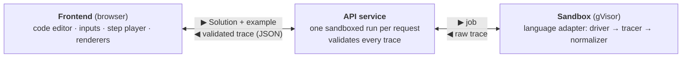

<p align="center">
  <picture>
    <source media="(prefers-color-scheme: dark)" srcset="logo-dark.svg">
    
  </picture>
</p>

<h1 align="center">Visi</h1>

<p align="center">Step through a LeetCode solution and watch its data structures change.</p>

## Inspiration behind the project
For most students learning visually is more effective rather than pure conceptual practice. Seeing the problem unfold and understanding why one solution may not work while another might as a data structure on the screen feels more tangible. Instead of picturing how a data structure works in a given problem, a visual can help immensely.

I want to help other aspiring software engineers with their goals of getting their dream job, and most of the time they need to go though multiple rounds of technical interviews, which are more often than not a multitude of LeetCode-style questions. With this in mind, those who are also visuals learners should use this tool to understand a given problem.

The rest of the file goes over the project, including the architecture, and decisions made throughout the process.

## What it does

You paste a LeetCode `Solution` class, give it an example input, and step through it. At every step the tool shows the line being executed and draws the data structures the solution is using (array, hash map, stack, queue, linked list, tree, graph, ...) as they change.

It works with the `Solution` class exactly as LeetCode gives it to you. No annotations or rewriting by hand are needed. There is no problem catalog: everything the visualizer needs is derived from your code and the example.

**Supported problems: algorithmic ones**, where you call one method of `Solution` with arguments (Two Sum, Reverse Linked List, Maximum Depth of Binary Tree, Clone Graph, Subsets, ...). The page shows one input field per parameter of that method. **Design problems are not supported yet**: LRU Cache, Min Stack, and the like, where the example is a sequence of calls on an object you construct (`["LRUCache","put","get"]` with `[[2],[1,1],[1]]`). One trace covering a whole call sequence needs a change to the trace format; it is planned for later ([`docs/driver-generation.md` §8](docs/driver-generation.md)).

## Status

> **Version 1.0.0-beta.1, a public beta.** Everything below works end to end in C++, Python, and Java. Bugs are fixed as they are reported (open an issue), and the beta becomes 1.0 once its traces have held up on real solutions. What changed, and why, is in [`CHANGELOG.md`](CHANGELOG.md).

### What you can do today

- **Paste a LeetCode `Solution` in C++, Python, or Java**, exactly as LeetCode gives it, and run it on an example. The inputs panel shows one field per parameter of the method, and pasting LeetCode's example text (`Input: ... Output: ...`) fills them.
- **Step through the run** line by line, forward and back, or play it at 0.5×, 1×, or 2×. The code panel highlights the line about to run, and the state panel shows the running statement, what it produced (a condition's result, a stored value, a return value), and every local.
- **See every structure drawn as it changes**: arrays and 2D grids, strings as characters, hash maps and sets, stacks, queues, deques, priority queues, tuples, linked lists, binary trees, and graphs. Pointer markers sit under the cells the code indexes, the cells a line read get a dashed outline, and every change is coloured and animated.
- **Follow recursion**: a recursion card (as a tree or as a stack) for calls that return values, and a call-stack card for calls that return nothing. Recursive and backtracking solutions show every call in progress.
- **Choose how a 2D array is drawn**: as a grid, a graph from an adjacency list, edge list, or matrix, or intervals on a number line.
- **See when two names are one container** (`dp = [[0] * 3] * 3` in Python, an array passed down a recursion in Java), with a note under the card.
- **Open one of eight example problems** from the Examples menu in each of the three languages, or from the home page.
- **Read what the program printed** in the Output tab, and the error with its stage when a run fails (a compile error at your line, an exception, a time limit).
- **Work in a dark or a light theme.**

Every run is a stranger's code, so it runs in a locked-down container under gVisor with no network and strict limits ([`docs/sandboxing.md`](docs/sandboxing.md)), and its trace is validated against the schema outside that container before the page sees it.

### Known limitations

- **Design problems are not supported** (LRU Cache, Min Stack, and the like, where the example is a sequence of calls on an object you construct). One trace covering a call sequence needs a change to the trace format ([`docs/driver-generation.md` §8](docs/driver-generation.md)).
- **A run stops recording at 2,000 steps, or once the trace reaches 10 MB.** The steps up to that point are still shown, and the page says which limit it was. Every step holds every value, so a large input (thousands of numbers) or recursion hundreds of calls deep reaches the size limit in a few hundred steps; a long loop reaches the step limit.
- **Lambdas are not traced** in C++ or Java, nor lambdas, generators, and comprehensions in Python: their lines take no steps of their own. Recursion written as a recursive lambda (`function<void(int)> dfs = [&](...)`) shows no calls.
- **C++ does not mark shared containers.** A `vector<int>&` passed down a recursion is drawn correctly in every frame, but without the note that the frames hold one container ([`docs/adapters/cpp.md`](docs/adapters/cpp.md) §10).
- **A C++ pointer that does not point at a live object** (dangling or uninitialized) is followed as if it were valid ([`docs/adapters/cpp.md` §3.7](docs/adapters/cpp.md#37-limits-of-address-identity)).
- **Where use decides the kind** is an open question: a Python list used through `heapq` is drawn as a priority queue, and a Java `Deque` used only through push, pop, and peek as a stack ([`docs/trace-format.md` §5](docs/trace-format.md#where-use-decides-the-kind)).
- **Hints are not inferred for locals.** A 2D-array parameter starts on the drawing its name and example suggest; a local starts as a grid or rows, and the card's View menu switches it.
- **The three languages' traces differ where the languages do**: step counts, hash-map order, and containers C++ declares without a value. [`tools/compare_traces.py`](tools/compare_traces.py) checks that they agree on everything else.

Per-language details are in each adapter's notes: [C++](docs/adapters/cpp.md), [Python](docs/adapters/python.md) §9, [Java](docs/adapters/java.md) §9.

## How it works



The browser sends your `Solution` and example to the API service, which runs them in a locked-down container for that language. There, a language adapter wraps your code in LeetCode's harness, records the state before every line, and turns each language's values into one neutral **trace format**: a JSON list of snapshots in which an `unordered_map`, a `dict`, and a `HashMap` are all just a `map`. The service validates the trace and sends it back, and the frontend replays it. The frontend never knows which language ran, so every structure is drawn the same way in C++, Python, and Java.

How each part works, and why it is set up this way, is in **[How Visi works](docs/architecture.md)**.

## Getting started

`python3 -m pipeline` takes a pasted Solution and an example to a validated trace in one command (it needs the rewriter built). You can also run the C++ adapter's tests and its end-to-end check, run the hand-instrumented Two Sum to write a real trace, check a trace, and open the frontend's page, which opens on the Two Sum example and, with the API service running, traces your own Solution on your inputs. CI runs the same commands on every push and pull request to `main`.

```bash
# Prerequisites: clang++ or g++ with C++20 <format> support, make, Python 3

# Run the C++ adapter's tests (clang++ by default)
make -C adapters/cpp
make -C adapters/cpp both          # with clang++ and with g++

# The checks below need the jsonschema package
pip install jsonschema

# End-to-end: Two Sum must equal the golden trace, and a program that never
# returns must stop at the step cap. Traces go to adapters/cpp/build/traces/
make -C adapters/cpp e2e

# Run the hand-instrumented Two Sum yourself. The trace goes to the path in TRACE_OUT
clang++ -std=c++20 -I adapters/cpp/runtime fixtures/two_sum_hand_inst.cpp -o /tmp/two_sum
TRACE_OUT=/tmp/two-sum.json /tmp/two_sum

# Check traces: schema always, plus equality with a fixture if asked
python3 -I tools/check_trace.py fixtures/*.trace.json
python3 -I tools/check_trace.py --equals fixtures/two-sum.trace.json /tmp/two-sum.json

# The driver: a Solution and an example in, a runnable program out
python3 -m driver fixtures/two_sum_trace.cpp --example "nums = [2,7,11,15], target = 9" --out /tmp/two-sum
python3 -m unittest discover -s driver/tests -t .    # its tests (they compile with $CXX, clang++, or g++)

# The rewriter (needs LLVM: brew install llvm), then a plain Solution end to end
make -C adapters/cpp/rewriter LLVM_CONFIG=$(brew --prefix llvm)/bin/llvm-config
python3 -m driver fixtures/max_depth_trace.cpp --example "root = [3,9,20,null,null,15,7]" --out /tmp/md --rewrite

# The whole pipeline in one command: driver, rewriter, compile, run, check.
# Without --sandbox it runs your code directly, with a 10-second limit.
python3 -m pipeline fixtures/two_sum_trace.cpp --example "nums = [2,7,11,15], target = 9" -o /tmp/two-sum.json
python3 -m unittest discover -s pipeline/tests -t .  # its tests (need the rewriter)

# The same run in the sandbox (needs Docker; gVisor on macOS: sandbox/colima-gvisor.yaml)
docker build -f sandbox/cpp.Dockerfile -t visi-sandbox-cpp .
python3 -m pipeline fixtures/two_sum_trace.cpp --example "nums = [2,7,11,15], target = 9" --sandbox gvisor
TRACE_SANDBOX=gvisor python3 -m unittest pipeline.tests.test_sandbox -v

# Python: the same command on a .py file (Python 3.12 on this machine, or its own image)
python3 -m pipeline fixtures/two_sum_trace.py --example "nums = [2,7,11,15], target = 9" -o /tmp/two-sum-py.json
docker build -f sandbox/python.Dockerfile -t visi-sandbox-python .
python3 -m pipeline fixtures/two_sum_trace.py --example "nums = [2,7,11,15], target = 9" --sandbox gvisor
python3 -m unittest discover -s adapters/python/tests   # the adapter's tests (pip install sortedcontainers==2.4.0 too)

# Java: the same on a .java file (JDK 21; build the adapter first), and every fixture's twins compared
make -C adapters/java
python3 -m pipeline fixtures/two_sum_trace.java --example "nums = [2,7,11,15], target = 9" -o /tmp/two-sum-java.json
docker build -f sandbox/java.Dockerfile -t visi-sandbox-java .
python3 -m unittest discover -s adapters/java/tests
python3 tools/compare_traces.py --all --core
```

```bash
# The API service (needs the sandbox images above). From the repository root,
# in a virtual environment (Homebrew's Python refuses system-wide pip installs):
python3 -m venv .venv && source .venv/bin/activate
python3 -m pip install jsonschema -r backend/requirements.txt
python3 -m backend                                   # http://127.0.0.1:8000, under gVisor by default
TRACE_SANDBOX=docker python3 -m backend              # without gVisor (Linux without runsc)
python3 -m unittest discover -s backend/tests -t .   # its tests
```

```bash
# Prerequisites: Node.js 20.19+ and npm

cd frontend
npm install
npm run dev        # the page on http://localhost:5173; /api is proxied to the API service on :8000
npm test           # vitest
npm run build      # typecheck + production build
```

## Documentation

| Document | Read it to learn |
|---|---|
| [How Visi works](docs/architecture.md) | The architecture: components, the adapter and frontend pipelines, the trace format in brief, tracing strategies, design decisions, open questions, the repository layout |
| [`docs/trace-format.md`](docs/trace-format.md) | The contract between backend and frontend: value kinds, steps, rules for adapter authors |
| [`docs/native-tracing.md`](docs/native-tracing.md) | How an adapter observes a program using runtime hooks or source instrumentation |
| [`docs/dap.md`](docs/dap.md) | How an adapter could observe a program through a debugger (Debug Adapter Protocol); not used yet |
| [`docs/driver-generation.md`](docs/driver-generation.md) | Parsing method signatures and example input, LeetCode helper types |
| [`docs/adapters/cpp.md`](docs/adapters/cpp.md), [`python.md`](docs/adapters/python.md), [`java.md`](docs/adapters/java.md) | Each language's adapter: how it traces, and its normalization rules |
| [`docs/sandboxing.md`](docs/sandboxing.md) | The sandbox: isolation, resource limits, how files get in and out, where validation runs |
| [`docs/backend.md`](docs/backend.md) | The API service: endpoints, errors and status codes, limits, settings |
| [`docs/frontend.md`](docs/frontend.md) | The sandbox page and the home page: layout, renderers, linked structures, calls cards, diffing, motion, themes |
| [`docs/hint-inference.md`](docs/hint-inference.md) | How an adapter works out which structure a value is when its type does not say (a proposal, partly built) |
| [`schema/trace.schema.json`](schema/trace.schema.json) | The machine-readable contract. Every adapter's output must validate against it |
| [`CONTRIBUTING.md`](CONTRIBUTING.md) | How to set up, test, and send a change; how to add a language |
| [`CHANGELOG.md`](CHANGELOG.md) | What changed in each version, and the history of the decisions behind it |
| [`CLAUDE.md`](CLAUDE.md), [`Skills.md`](Skills.md), [`frontend/CLAUDE.md`](frontend/CLAUDE.md) | Rules and repeatable procedures for working in this repo |

Plans and bugs are tracked in [GitHub issues](https://github.com/MatthewYu402/LeetCode-Visualizer/issues).

## Adding a new language

An adapter needs a driver template, a tracer (or a DAP configuration), a normalizer, helper types, and a container image. The frontend and trace schema do not change. The full checklist is in [`trace-format.md` §11](docs/trace-format.md#11-adding-a-new-language), and the how-to is in [`CONTRIBUTING.md`](CONTRIBUTING.md#6-adding-a-language).

## License

Released under the [Apache License 2.0](LICENSE). See [`NOTICE`](NOTICE) for the copyright notice to keep with copies and derived works.

## Acknowledgements

- [Python Tutor](https://pythontutor.com) for the heap-of-objects-plus-references model of program state.
- The [Debug Adapter Protocol](https://microsoft.github.io/debug-adapter-protocol/) for the idea that one client can drive many language backends.