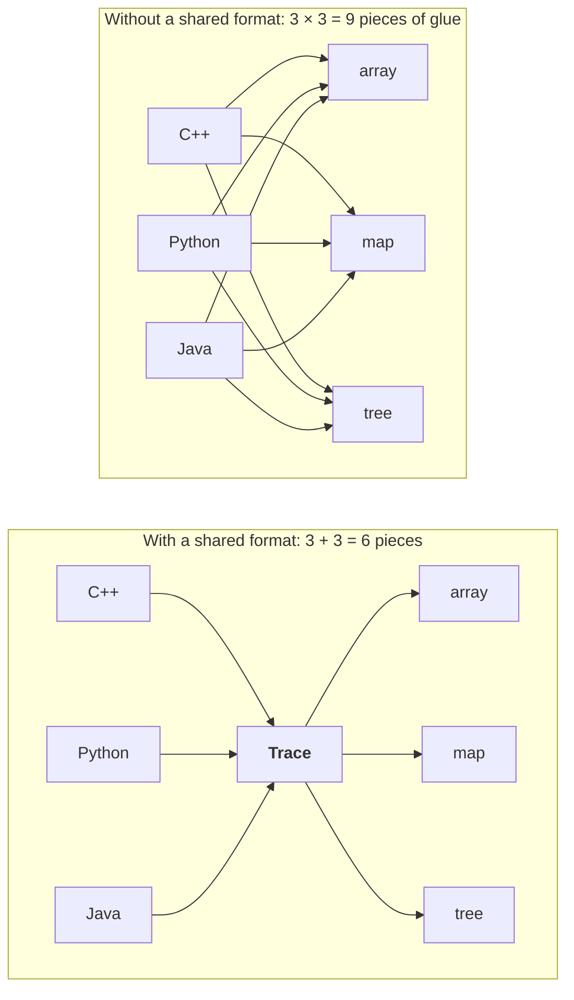
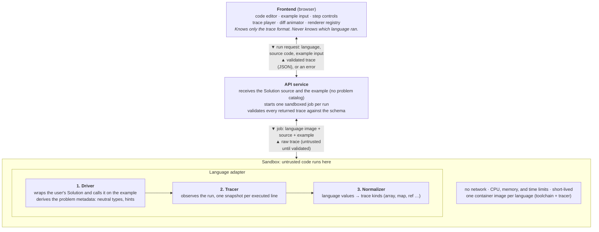
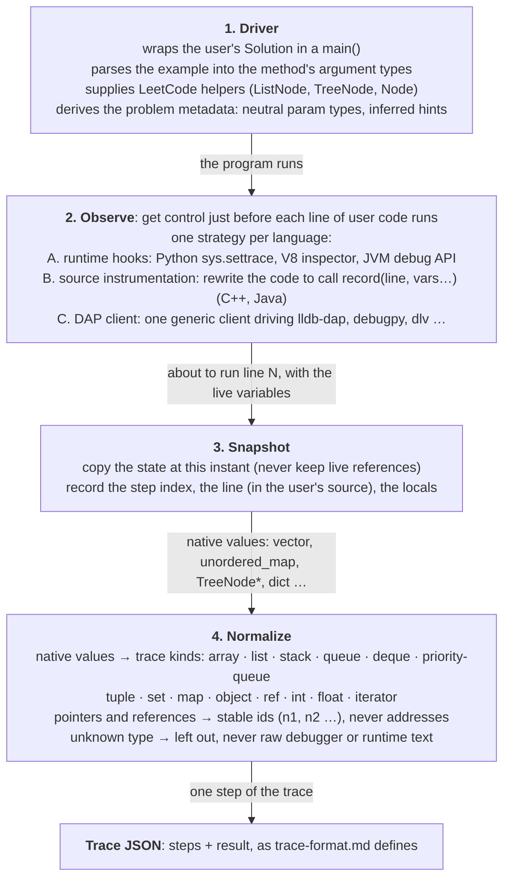
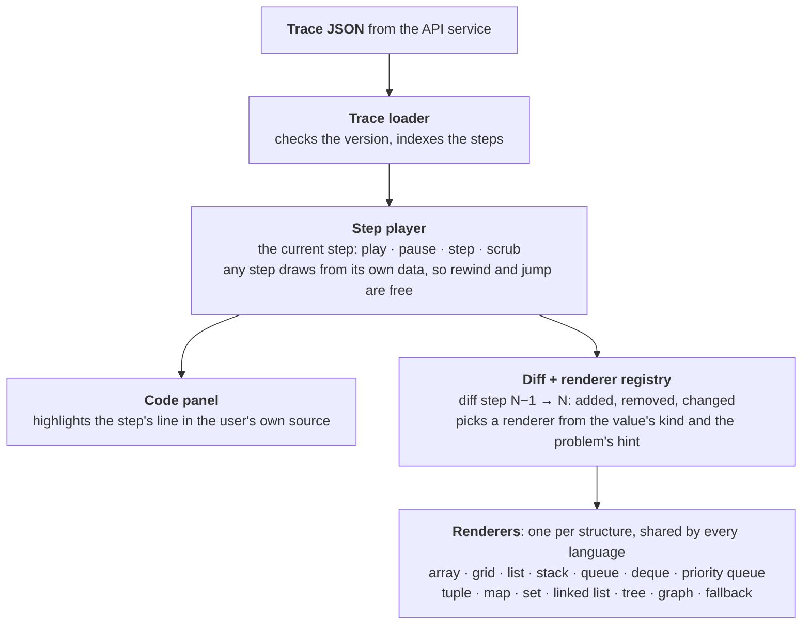
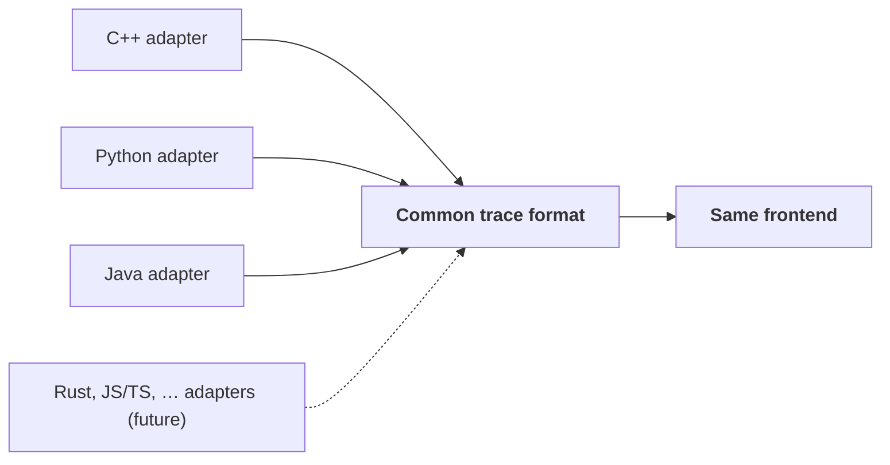

# How Visi works

> **Status:** Beta (Visi 1.0.0-beta.1). The architecture as built, and why it is set up this way.
> **Related:** [`../README.md`](../README.md) (what Visi does and how to run it), [`trace-format.md`](trace-format.md) (the contract), [`../CONTRIBUTING.md`](../CONTRIBUTING.md) (how to change it)

Visi steps through a LeetCode `Solution` and draws its data structures as they change. Getting state out of a running `Solution` class without asking the user to change their code is the hard part, so this is where most of the design effort went.

The key decision: **the backend and the frontend only talk through a trace format.** Each side can be built, tested, and replaced without the other. The data flow and the boundaries between the components are the stable part of this design; how the service is hosted is not described here.

## 1. Why a trace format sits in the middle

Without a shared format, every language needs its own drawing code for every structure: L languages × R renderers. With one, each language writes the trace and one frontend reads it: L + R.



Adding a language costs one adapter. Adding a renderer works for every language at once. The trace format is the only thing both sides share, so it is the only thing that must stay stable.

## 2. System overview: what is connected to what



| Component | Responsibility | Language-aware? |
|---|---|---|
| **Frontend** | Replays a trace: highlights the current line, draws each structure, animates changes | **No** |
| **API service** | Receives the source and example, orchestrates jobs, **validates every trace** | **No** |
| **Sandbox** | Runs untrusted code with strict limits | Only the image it starts from |
| **Language adapter** | Driver, tracer, normalizer, problem metadata and hints | **Yes. This is the only place language knowledge lives** |

Everything that comes out of the sandbox is treated as **untrusted data**. The user's code runs in the same environment as the tracer, so the trace is checked against the schema outside the sandbox before the frontend ever sees it.

### Components

| Area | State |
|---|---|
| Trace format, schema, and golden fixtures | v0.15. Six problems (Two Sum, Reverse Linked List, iterative preorder, Clone Graph, Maximum Depth, Subsets), each in C++, Python, and Java, with the other languages' traces matching the C++ one call by call |
| C++ adapter | Header-only runtime, a Clang LibTooling rewriter that instruments a plain Solution without adding lines, and a driver that rebuilds LeetCode's harness |
| Python adapter | `sys.settrace` for the steps and a syntax-tree rewrite for what each line evaluated, on Python 3.12 |
| Java adapter | Source instrumentation on the JDK's own parser, compiled with javac in the same JVM, on JDK 21 |
| CLI (`pipeline/`) | `python3 -m pipeline` takes a Solution and an example to a validated trace in one command, on this machine or in the sandbox |
| Sandbox (`sandbox/`) | One image per language; one container per run with no network, capped memory, CPU, processes, disk, and time, never root, under gVisor |
| API service (`backend/`) | `/api/signature` and `/api/run`, with size caps, run slots and a capped line, and one run per visitor |
| Frontend (`frontend/`) | The home page and the sandbox page, in a dark and a light theme |
| CI | Every push and pull request to `main`: fixtures, every adapter's tests on Linux and macOS, the three sandbox images under Docker and gVisor, the frontend's tests and build |

## 3. Inside a language adapter

An adapter turns "the user's code plus an example" into a trace, in four stages.



- **Only stage 2 differs fundamentally between languages.** Stages 3 and 4 have the same shape everywhere but different details.
- Native tracers usually do stages 3 and 4 in one pass. A DAP client normalizes what the debugger returned after the fact.
- **Every observation strategy ends in the same normalized kinds and the same schema validation.** The frontend cannot tell which strategy produced a trace.

The strategies are compared in [§8](#8-tracing-strategies), and described in full in [`native-tracing.md`](native-tracing.md) (A, B) and [`dap.md`](dap.md) (C).

## 4. Inside the frontend



The frontend picks a renderer in this order: the user's "view as" override, then the inferred hint, then the value `kind`, then the shape of an `object`, then a generic fallback.

| Trace value | Hint | Renderer |
|---|---|---|
| `array` | | Indexed boxes with pointer markers (`i`, `left`, `right`) |
| `array` of `array` | `grid` / `adjacency-matrix` | 2D grid |
| `array` of `array` | `adjacency-list` / `edge-list` / `graph` | Node-link diagram |
| `array` of `array` | `intervals` | Intervals on a number line |
| `list` | | Chain of value nodes |
| `stack` | | Vertical column, top at the top |
| `queue` / `deque` | | Horizontal row, front at the left |
| `priority-queue` | | Array plus tree view, top highlighted |
| `tuple` | | Fixed group of values |
| `map` | | Key-value table |
| `set` | | Set of items |
| `object` + `ref` | `tree`, or shape `val` + `left` + `right` | Tree layout |
| `object` + `ref` | `linked-list`, or shape `val` + `next` | Nodes and arrows |
| `object` + `ref` | `graph`, or shape `val` + `neighbors` | Node-link diagram |
| unknown kind | | Generic fallback |

An `array<array<int>>` could be a grid, an adjacency list, or intervals. The adapter infers a hint, and a user-selectable "view as" override corrects it, so the ambiguity is resolved once instead of once per language.

The frontend's full design is in [`frontend.md`](frontend.md).

## 5. Worked example: Two Sum

Input `nums = [2, 7, 11, 15]`, `target = 9`, using the `Solution` from LeetCode as-is. The full trace is in [`fixtures/two-sum.trace.json`](../fixtures/two-sum.trace.json). One step of it:

```json
{
  "step": 5,
  "frames": [
    {"id": "f1", "function": "twoSum", "line": 8,
     "locals": {
       "nums":   {"kind": "array", "items": [2, 7, 11, 15]},
       "target": 9,
       "numMap": {"kind": "map", "entries": [[2, 0]]},
       "i": 1
     }}
  ],
  "heap": {}
}
```

`frames` is the call stack, bottom to top. Two Sum calls no function of its own, so it always has one frame. A recursive solution has one frame per call level, each with its own `line` and `locals`, and every call ends with a **return step** whose top frame carries `return_value`, so you can watch the answer travel back up the stack. See [steps](trace-format.md#6-steps).

What the frontend draws for that step:

```
  line 8:   int complement = target - nums[i];      <- highlighted in the code panel

  nums     ┌────┬────┬────┬────┐
           │  2 │  7 │ 11 │ 15 │
           └────┴────┴────┴────┘
              0    1    2    3
                   ▲
                   i

  numMap   ┌─────┬───────┐
           │ key │ value │
           ├─────┼───────┤
           │  2  │   0   │     <- added since the last visit to line 8 (found by the diff)
           └─────┴───────┘
```

The frontend reads `nums` as an `array` and `numMap` as a `map`. It never learns that `numMap` was a C++ `unordered_map`.

## 6. The trace format in brief

The full specification is [`docs/trace-format.md`](trace-format.md). The short version: every value is a primitive or a tagged object, and the `kind` field says which renderer applies. The type decides the kind:

```json
{"kind": "array",          "items": [2, 7, 11, 15]}
{"kind": "stack",          "items": [1, 2, 3]}
{"kind": "queue",          "items": [1, 2, 3]}
{"kind": "priority-queue", "items": [5, 4, 3, 1, 1], "order": "max"}
{"kind": "tuple",          "items": [0, "a"]}
{"kind": "set",            "items": [1, 2]}
{"kind": "map",            "entries": [[2, 0]]}
{"kind": "ref",            "id": "n3"}
```

The full list (`array`, `list`, `stack`, `queue`, `deque`, `priority-queue`, `tuple`, `set`, `map`, `object`, `ref`, `int`, `float`, and `iterator` for a position in a container) is in the [summary of kinds](trace-format.md#summary-of-kinds). A container reached from more than one place, such as two names for one list, carries the same `id` at every place, so the frontend can show they are one ([shared containers](trace-format.md#shared-containers)). What the type cannot say, such as whether an `array` of `array`s is a grid or a graph, is a **hint** that the adapter infers.

Numbers are plain JSON whenever JavaScript can read them back exactly, as the kind they are. Three cases cannot be, so they are tagged, with the exact value kept in a string:

```json
{"kind": "int",   "value": "9007199254740993"}
{"kind": "float", "value": "NaN"}
{"kind": "float", "value": "3.0"}
```

`int` is for integers outside ±(2^53 − 1), which `JSON.parse` would silently round. `float` is for `NaN`, `Infinity`, and `-Infinity`, which JSON has no syntax for, and for whole floats like `3.0`, which a bare `3` would turn into an int. See [numbers JSON cannot carry exactly](trace-format.md#numbers-json-cannot-carry-exactly).

A trace also says how the run ended. `result` is present only when the method returned, and `"truncated": true` appears only when recording stopped at a limit, with `truncated_by` saying which: the 2,000-step limit (`"steps"`) or the 10 MB size budget (`"size"`). At a limit the adapter writes the trace straight away, so a solution stuck in an infinite loop still gives you a trace to step through instead of only a timeout. See [unfinished runs](trace-format.md#unfinished-runs).

When the method returns a pointer, `result` is a `ref`, and the objects it points to come in a top-level `result_heap` with the same shape as a step's `heap` and the same ids. A `void` method that returned has `"result": null`, and the problem metadata says `"returns": {"type": "void"}`, which tells it apart from a returned null pointer. See [the return value](trace-format.md#the-return-value).

For linked structures (trees, linked lists, graphs) the trace uses Python Tutor's approach: a **heap of objects with ids**, plus **references** between them. A C++ `TreeNode*`, a Python `TreeNode` object, and a Java `TreeNode` reference all become the same thing:

```json
{
  "frames": [{"id": "f1", "function": "maxDepth", "line": 4,
              "locals": {"root": {"kind": "ref", "id": "n3"}}}],
  "heap": {
    "n3": {"kind": "object", "type": "TreeNode",
           "fields": {"val": 5,
                      "left":  {"kind": "ref", "id": "n4"},
                      "right": null}},
    "n4": {"kind": "object", "type": "TreeNode",
           "fields": {"val": 3, "left": null, "right": null}}
  }
}
```

The frontend recognizes a tree by shape (an object with `val`, `left`, and `right`), or from a hint in the problem metadata such as "this parameter is a `TreeNode`". See [value model](trace-format.md#5-the-value-model) and [steps](trace-format.md#6-steps).

A step is taken before its line runs, so the top frame can also carry `outcomes`: what its line evaluated once it ran, such as a condition that was false, the value a store left, or the cell a read used (`dp[i - 1][j]`). The frontend shows them next to the line instead of guessing. See [outcomes](trace-format.md#outcomes).

```json
"outcomes": [{"kind": "condition", "code": "numMap.count(complement)", "value": false}]
```

## 7. Language-agnostic design

**Language-agnostic** means the visualizer never depends on the language a solution was written in. A solution in C++, Python, Java, or any other supported language produces the same visualization for the same problem and input.

It works because the system is split into two halves that communicate only through the shared trace format:

1. **Language adapters (backend).** Each supported language has an adapter with three jobs:
   - **Driver generation:** wrap the user's `Solution` so it can be called with the parsed example. LeetCode signatures differ by language (`vector<int>&` vs `List[int]` vs `int[]`), but every adapter derives the same problem metadata (parameter names, neutral types, inferred hints).
   - **Tracing:** run the code and record a snapshot per step.
   - **Normalization:** convert language-specific values (`std::unordered_map`, `dict`, `HashMap`) into the shared value model.
2. **Visualization engine (frontend).** Reads only the trace. It knows nothing about C++ or Python, chooses a renderer from the normalized kinds, and animates the changes between steps.



### What this guarantees
- Adding a new language requires only a new adapter. The frontend and trace schema stay unchanged.
- Adding a new data structure renderer works for every language at once.
- Two solutions to the same problem in different languages can be compared side by side, because they emit the same kind of trace.

### What this does not mean
- It does not mean translating code between languages. Each solution runs in its own language.
- It does not mean every language produces identical traces. Different algorithms, iteration orders (for example, hash maps), and value semantics (copy vs. reference) can still change what is shown. The model normalizes *representation*, not *behavior*. See [rules for adapter authors](trace-format.md#8-rules-for-adapter-authors).
- It does not mean all languages are supported on day one. The trace format is the contract, and languages are added incrementally.

## 8. Tracing strategies

An adapter observes the running program in one of three ways. All three end in the same normalized trace.

| Strategy | How it works | Good for | Doc |
|---|---|---|---|
| **Runtime hooks** | The runtime calls our code before each line (Python `sys.settrace`, V8 inspector, JVM debug interfaces) | Python, JavaScript, Java | [`native-tracing.md`](native-tracing.md) |
| **Source instrumentation** | Rewrite the code to call a recording function (`trace::record(...)` in C++) before each statement, then run it | C++, Go (full control over STL serialization) | [`native-tracing.md`](native-tracing.md) |
| **DAP client** | One generic client drives an external debugger (`lldb-dap`, `debugpy`, `dlv`) | Breadth: adding languages cheaply | [`dap.md`](dap.md) |

The dividing line is who writes the per-language logic. With native tracing we write a tracer per language. With DAP the stepping logic is written once, and what remains per language is a launch configuration and normalization rules.

Order: **C++** and **Java** (instrumentation) and **Python** (runtime hooks) are implemented; others follow, using DAP where a native tracer would be expensive.

## 9. Design decisions

These are the decisions that shaped the project. Each links to where it is explained in full.

| Decision | Why | Details |
|---|---|---|
| **Contract first.** A trace format sits between backend and frontend | Turns an L × R problem into L + R, and lets each half be built and tested alone | [`trace-format.md` §1](trace-format.md#1-why-this-exists) |
| **Snapshots, not an event log** | Any step draws from its own data, so rewind and jump are free. Costs size, which is negligible for small examples with a step cap | [`trace-format.md` §6](trace-format.md#6-steps) |
| **Normalize representation, never hide behavior** | The same concept always looks the same in the trace, but real differences (map ordering, overflow) are not erased | [`trace-format.md` §8](trace-format.md#8-rules-for-adapter-authors) |
| **Deliberately lossy** | Drops addresses, buckets, capacity. A small format is a stable format | [`trace-format.md` §2](trace-format.md#2-design-principles) |
| **Abstract, not primitive** | The trace raises `unordered_map` and `dict` up to one concept (`map`) instead of lowering toward the machine like a compiler IR | [`trace-format.md` §1](trace-format.md#1-why-this-exists) |
| **The type decides the kind, the problem decides the hint** | `stack<int>` is a `stack` from its type alone. Whether an `array` of `array`s is a grid or a graph is only knowable from the problem, so it is a hint | [`trace-format.md` §5](trace-format.md#summary-of-kinds) |
| **Hints are inferred, never asked for** | There is no problem catalog. The adapter infers hints from types, parameter names, and code patterns, and a "view as" override corrects them | [`trace-format.md` §4](trace-format.md#4-problem-metadata) |
| **Bare numbers only when exact** | Integers beyond ±(2^53 − 1), NaN/±Infinity, and whole floats are tagged so JavaScript never silently rounds, fails to parse, or turns 3.0 into an int | [`trace-format.md` §5](trace-format.md#numbers-json-cannot-carry-exactly) |
| **Tracer output is untrusted** | User code runs next to the tracer, so run it in a sandbox and validate the trace outside it | [`native-tracing.md` §6](native-tracing.md#6-security) |
| **Two observation strategies behind one contract** | Native tracing gives control, DAP gives breadth. The frontend cannot tell them apart | [`dap.md` §8](dap.md#8-native-tracing-vs-dap) |

## 10. Open questions

Gaps in the trace format that the tracing work exposed. They are planned for a minor version. Details in [`native-tracing.md` §8](native-tracing.md#8-open-questions).

1. **Pointers that do not point at a live object.** A dangling or uninitialized C++ pointer is followed as if it were valid, and the trace has no way to say "this points at nothing". A documented limit for now ([`docs/adapters/cpp.md` §3.7](adapters/cpp.md#37-limits-of-address-identity)).

Resolved: tuples, which v0.1 flattened to `list`, have the `tuple` kind since v0.2. A `ref` result, which had no heap to point into, has `result_heap` since v0.5. The call stack, which recursive solutions need, is `frames` with return steps since v0.6. Iterators, which had no kind and were left out, are `iterator` values naming a local container since v0.7. What a line evaluated, a condition's result or the value a store left, is the top frame's `outcomes` since v0.8. Which locals index which array, which a list of conventional names guessed at, is `indexes` since v0.9. Which cells a line read, which nothing recorded, is the `read` outcome since v0.10. Member variables of the `Solution` (memo tables, visited sets), which had nowhere to go, are a step's `members` since v0.12. A whole float, which a bare `3` made look like an int, is a tagged `float` since v0.13. Two names for one container, which looked like two copies, share an `id` since v0.14.

## 11. Tech stack

The architecture does not depend on these choices: another adapter or another frontend only has to read or write the trace format.

| Layer | Choice |
|---|---|
| C++ adapter | C++20, header-only runtime, Clang LibTooling for the rewriter |
| Python adapter | Python 3.12, `sys.settrace` and the `ast` module, standard library only (plus `sortedcontainers` for Solutions to use) |
| Java adapter | JDK 21, the JDK's own parser and compiler (`com.sun.source`, `javax.tools`), no third-party libraries |
| Frontend | React + TypeScript + Vite, Monaco editor for the code panel |
| Renderers | HTML and SVG with Framer Motion, for containers and for linked lists, trees, and graphs (decided, [`docs/frontend.md`](frontend.md) §6) |
| API service | FastAPI on Uvicorn (decided, [`docs/backend.md`](backend.md)) |
| Sandbox | Docker with gVisor (`runsc`), one container per run, strict CPU, memory, process, disk, and time limits (decided, [`docs/sandboxing.md`](sandboxing.md)) |
| Contract | JSON Schema, validated in CI and at runtime |

## 12. Repository layout

```
.
├── README.md
├── logo-dark.svg, logo-light.svg   the Visi eye for dark and light backgrounds (the README picks by theme)
├── CHANGELOG.md               what changed in each version, and why
├── CONTRIBUTING.md            setting up, testing, sending a change, adding a language
├── CLAUDE.md                  rules for working in this repo
├── Skills.md                  repeatable procedures
├── LICENSE                    Apache License 2.0
├── NOTICE                     the copyright notice to keep with copies
├── .clang-format              C++ formatting (attached braces, 2 spaces)
├── .github/
│   └── workflows/
│       └── ci.yml             CI: fixtures, the C++, Python, and Java adapters, sandbox, frontend
├── docs/
│   ├── architecture.md        how Visi works (this file)
│   ├── trace-format.md        the contract
│   ├── native-tracing.md      runtime hooks and source instrumentation
│   ├── dap.md                 DAP-based tracing
│   ├── driver-generation.md   signatures, example parsing, helper types
│   ├── frontend.md            the sandbox and home pages: registry, diff, playback, routes
│   ├── sandboxing.md          isolation, limits, where validation runs
│   ├── backend.md             the API service: endpoints, errors, limits
│   ├── hint-inference.md      (proposal) inferring hints
│   ├── manual-test-suite.md   cases to paste into the page by hand, in every language
│   ├── local-testing.md       running everything on a Mac, step by step
│   └── adapters/
│       ├── cpp.md             the C++ adapter
│       ├── python.md          the Python adapter
│       └── java.md            the Java adapter
├── schema/
│   └── trace.schema.json      machine-readable contract
├── fixtures/
│   ├── <name>.trace.json      golden traces: two-sum, reverse-list,
│   │                          preorder-traversal, clone-graph,
│   │                          max-depth, subsets
│   ├── <name>_trace.cpp       the solution each golden trace records
│   ├── <name>_hand_inst.cpp   the same solution, instrumented by hand
│   ├── <name>_trace.py        the same solution in Python
│   ├── <name>.python.trace.json  its golden trace (like the C++ one: check_trace.py --like)
│   ├── <name>_trace.java      the same solution in Java
│   └── <name>.java.trace.json its golden trace
├── tools/
│   ├── check_trace.py         validate a trace; compare with a fixture, or with another language's (--like)
│   └── compare_traces.py      two languages' traces of one Solution, call by call (--all: every fixture's twins)
├── pipeline/                  the CLI: python3 -m pipeline SOLUTION --example TEXT
│   ├── __init__.py            run(): driver, rewriter, compile, run, validate (C++ or Python)
│   ├── __main__.py            the command line and its exit codes
│   ├── runners.py             where stages 2 to 4 run: this machine, or a container (one image per language)
│   └── tests/                 every fixture end to end, each failure, each sandbox limit
├── sandbox/                   the sandbox (docs/sandboxing.md)
│   ├── cpp.Dockerfile         the C++ image: rewriter, clang++, runtime headers
│   ├── cpp.Dockerfile.dockerignore  its build context
│   ├── python.Dockerfile      the Python image: Python 3.12, sortedcontainers, the adapter
│   ├── python.Dockerfile.dockerignore  its build context
│   ├── java.Dockerfile        the Java image: JDK 21, the adapter compiled
│   ├── java.Dockerfile.dockerignore  its build context
│   └── colima-gvisor.yaml     gVisor on macOS: a Colima profile's runsc setup
├── driver/                    LeetCode's harness, rebuilt (Python): python3 -m driver
│   ├── example.py             example text -> neutral JSON (every language)
│   ├── shapes.py              LeetCode's notations for lists, trees, graphs (every language)
│   ├── hints.py               a 2D-array parameter's hint, from its name and the example's shape (every language)
│   ├── cpp/                   signature, node comments, prelude and main for C++
│   ├── python/                signature (type hints), node comments, run.json for Python
│   ├── java/                  signature, node comments, LvMain.java and Nodes.java for Java
│   └── tests/                 unit tests, compile-and-run tests, golden fixtures
├── adapters/
│   ├── python/
│   │   ├── run.py             the program: run.json in, the method run under the tracer, the trace out
│   │   ├── tracer.py          sys.settrace steps, normalization, outcomes, the document writer
│   │   ├── instrument.py      the syntax-tree rewrite: outcome calls, indexes, heapq lists
│   │   └── tests/             every fixture, kinds, outcomes, limits (Python 3.12)
│   ├── java/
│   │   ├── Makefile           compiles the adapter to build/classes
│   │   ├── src/lvtrace/       Build (rewrite + javac), Rewriter, Trace (the runtime), Snapshot, Args, ...
│   │   └── tests/             every fixture, kinds, outcomes, limits (JDK 21)
│   └── cpp/
│       ├── Makefile           the adapter's tests and end-to-end check
│       ├── rewriter/          trace-rewrite: inserts record() etc. (Clang LibTooling)
│       │   ├── instrumenter.hpp / .cpp   the AST visitor
│       │   ├── main.cpp       the tool
│       │   └── Makefile       builds with llvm-config; make test
│       ├── runtime/
│       │   ├── trace.hpp      serializers, recorder, document writer
│       │   ├── leetcode_types.hpp  ListNode, TreeNode, and their field tables
│       │   └── prelude_common.hpp  the standard headers every prelude includes (precompiled in the sandbox)
│       └── tests/
│           ├── test_serialize.cpp
│           ├── test_record.cpp
│           ├── test_write_file.cpp
│           ├── test_pointers.cpp
│           ├── test_frames.cpp
│           ├── test_document.cpp
│           ├── test_iterators.cpp
│           └── programs/
│               ├── loop_forever.cpp    never returns; proves the step cap
│               ├── return_pointer.cpp  returns a ListNode*; proves result_heap
│               └── void_method.cpp     returns void; proves the null result
├── frontend/                  home page and sandbox page (React + TypeScript + Vite)
│   ├── CLAUDE.md              commands, structure, rules
│   ├── package.json
│   ├── vite.config.ts
│   └── src/
│       ├── App.tsx            the switch between the pages; loads the sandbox lazily
│       ├── Sandbox.tsx        the sandbox page: layout, language select, shortcuts
│       ├── route.ts           the hash route: #/ home, #/sandbox, #/sandbox/<example>
│       ├── theme.ts           the page's theme: dark or light, the system's setting, the toggle
│       ├── home/              the home page, its live preview, and its example problems
│       ├── assets/            the logo, one file per theme
│       ├── api/               API client, input form logic, useInputs hook
│       ├── trace/             types, loader, value formatting, diff, heap edges, call tree
│       ├── player/            playback reducer and Run timer
│       ├── render/            renderer registry, renderers, heap layout and drawing
│       ├── components/        toolbar, code, inputs, visual, state panels, calls cards, the running canvas
│       ├── editor/            Monaco setup, theme, starter templates
│       └── styles/            theme tokens and layout
└── backend/                   the API service (FastAPI): python3 -m backend
    ├── app.py                 /api/health, /api/signature, /api/run
    ├── __main__.py            serves it with Uvicorn on 127.0.0.1:8000
    ├── requirements.txt       fastapi, uvicorn (and httpx for the tests)
    └── tests/                 every endpoint and error, and a real run in the sandbox
```
