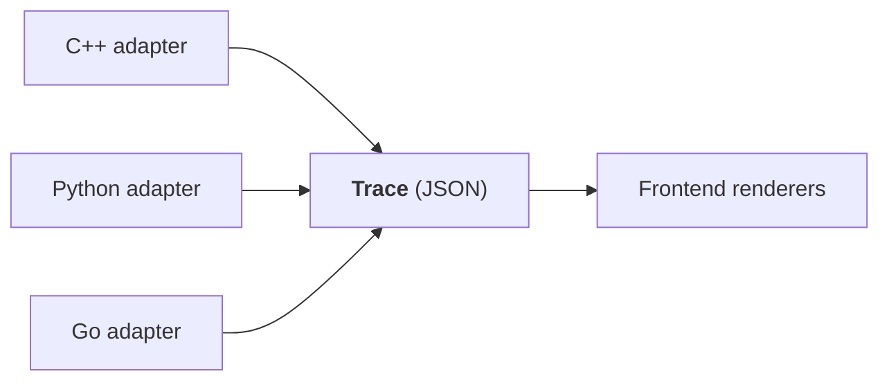

# Trace Format Specification
> **Status:** Beta (Visi 1.0.0-beta.1) · trace format v0.15
> **Related:** [`native-tracing.md`](native-tracing.md) and [`dap.md`](dap.md) (how adapters produce traces), [`schema/trace.schema.json`](../schema/trace.schema.json) (the machine-readable contract), [`fixtures/two-sum.trace.json`](../fixtures/two-sum.trace.json) (golden trace)

Suppose we built the visualizer without a trace format. The C++ backend sends the frontend whatever is easiest to produce, say a raw dump of `std::unordered_map` internals.

The frontend learns to parse that. Later you add Python, whose `dict` looks nothing like it, so you need to add Python specific parsing to the frontend. Then Java.

Now:
- The frontend contains `if language == "cpp"` branches everywhere.
- Every new renderer (say, a priority-queue view) has to be taught about every language.
- Every new language has to be taught about every renderer.

The trace format is the **only contract** between the language-specific backend (adapters) and the visualization frontend. Adapters produce traces and the frontend consumes them. Neither side knows anything about the other.

A contract is only useful if both sides can rely on it.

## 1. Why this exists
Without a shared format, every language would need to be taught to every renderer. With $L$ languages and $R$ renderers, that's $L\times R$ pieces of glue code, and it grows with every feature.

With a shared format in the middle:



the cost drops to $L + R$. Adding Go means writing one adapter. Adding a priority-queue renderer means writing one component. Neither touches the other side.

> **Key Insight 1: the trace is the only thing both sides share, so it is the only thing that must stay stable.**

#### An Analogy, with a caveat
The trace plays a similar role to an intermediate representation (IR) in a compiler: it decouples many frontends from many backends. But there is an important difference:
- A compiler IR represents what a program **does** (instructions) and gets transformed and optimized.
- A trace represents what a program's data **looks like** at each moment. Nothing is compiled, translated, or optimized. The user's code always runs in its original language, and the trace is a recording of that run.

A closer precedent is the Debug Adapter Protocol: one UI, many language backends, and one shared message format.


## 2. Design Principles

| Principle | Meaning | Why |
|---|---|---|
| **Language-neutral** | Describes concepts (`map`, `array`, `ref`), not implementations (`std::unordered_map`, `dict`) | If language details leak in, the frontend becomes language-aware again and the whole benefit is lost |
| **Self-contained** | Each step has everything needed to draw the moment | Any step can be rendered alone, so rewind and jump are trivial |
| **Declarative** | States what *is* ("the map contains [2, 0]"), not what *happened* ("insert [2, 0]") | Robust and simple to render. The frontend computes diffs itself |
| **Deliberately lossy** | Drops memory addresses, hash buckets, capacity, allocator details | A small format is a stable format, with less for languages to disagree about |
| **Bare numbers only when exact** | JSON is parsed into JavaScript doubles, so large integers would silently round and NaN or Infinity would not parse at all. Those values are tagged instead of approximated | [Section 5](#numbers-json-cannot-carry-exactly) |

> **Key Insight 2: the trace is more *abstract* than the source language, not more primitive.** A compiler lowers toward the machine (registers, loads, stores). The trace raises `std::unordered_map` and Python `dict` up to one standard concept: `map`.

## 3. Trace structure
A trace is one JSON object:

```json
{
  "version": "0.15",
  "language": "cpp",
  "problem": { ... },
  "indexes": { ... },
  "steps": [ ... ],
  "result": ...,
  "result_heap": { ... }
}
```

| Field | Description |
|---|---|
| `version` | Trace format version (see [Section 9](#9-versioning)) |
| `language` | Informational only. The frontend must **not** branch on this. |
| `problem` | Metadata about the problem and input ([Section 4](#4-problem-metadata)) |
| `indexes` | Optional. Which integer locals each function uses to index which of its containers ([Indexes](#indexes)). Present only when some function does |
| `steps` | Ordered list of snapshots ([Section 6](#6-steps)) |
| `result` | Optional. Final return value, as a normalized value. Absent means the method did not return ([Unfinished runs](#unfinished-runs)). `null` for a `void` method that returned ([The return value](#the-return-value)) |
| `result_heap` | Optional. The objects `result` refers to, in the same shape as a step's `heap`. Present only when `result` contains a `ref` ([The return value](#the-return-value)) |
| `truncated` | Optional. Present only as `true`, when recording stopped at a limit ([Section 6](#limits)). Never `false` |
| `truncated_by` | Present exactly when `truncated` is: which limit stopped recording, `"steps"` (the step limit) or `"size"` (the size budget) ([Section 6](#limits)) |

#### Unfinished runs
Two top-level fields describe how the run ended. Each is written only when it has something to say:

- **`result` is present only when the method returned.** If the run was truncated at the step limit, crashed, or was killed, there is no return value, so the field is left out. It is never filled with `null` as a placeholder, because `null` is a real return value ("no value", see [Primitives](#primitives)).
- **`truncated` is present only as `true`.** A trace that was not truncated leaves the field out. `"truncated": false` is invalid.
- **`truncated_by` says which limit it was**, and is present exactly when `truncated` is: `"steps"` when recording reached the step limit, `"size"` when the steps reached the size budget. The two have different causes (usually an infinite loop, and an input too large to trace in full), and a reader is told different things about each.

An absent `result` does **not** mean a wrong answer. A wrong solution still returns a value, and that value is the `result`. The visualizer has no expected answer to compare against.

| `result` | `truncated` | What happened |
|---|---|---|
| present | absent | The method returned. This is the normal case |
| absent | `true` | Recording stopped at a limit before the method returned: at the step limit (`truncated_by: "steps"`), usually an infinite loop, or at the size budget (`"size"`), an input too large, or recursion too deep, to trace in full |
| absent | absent | The run ended early for another reason, such as a crash. The format allows this, but it does not yet require adapters to produce a trace here |
| present | `true` | Recording stopped at the limit, the adapter let the program run on, and the method returned |

#### The return value
`result` is a normalized value like any other, with two cases that need more than the value itself.

**A returned object needs a heap.** A method such as Reverse Linked List returns a pointer, so its `result` is a `ref`. Every step carries its own `heap`, but `result` sits at the top level, outside every step. `result_heap` is the heap for the result:

```json
{
  "result": {"kind": "ref", "id": "n2"},
  "result_heap": {
    "n2": {"kind": "object", "type": "ListNode",
           "fields": {"val": 2, "next": {"kind": "ref", "id": "n3"}}},
    "n3": {"kind": "object", "type": "ListNode",
           "fields": {"val": 3, "next": null}}
  }
}
```

- It has the same shape as a step's `heap`, and it holds every object reachable from `result`. Every `ref` in `result` and in `result_heap` names an entry of `result_heap`.
- **Ids are the same ones the steps use.** `n2` here is the object that was `n2` in every step, so the frontend can show the returned node as the node the user has been watching.
- It is written only when it says something: present only when `result` contains a `ref`, so it is never empty and never appears without `result`.
- It shows the objects **as they are when the method returns**. The last step cannot stand in for it, because a step is taken before its line runs ([Q13](#12-design-questions)).

**A `void` method returns no value.** Problems that change their input in place (Sort Colors, Rotate Image) have nothing to return. When such a method returns, `result` is `null`: the method did return, and there is no value. Leaving `result` out would say the run never finished.

`null` alone is ambiguous, because a method that returns a pointer can return a null pointer. The return type settles it: `problem.returns.type` is `"void"` for a method with no return value ([Section 4](#4-problem-metadata)). An adapter **must** write `returns` for a `void` method.

| `result` | `problem.returns.type` | What happened |
|---|---|---|
| absent | anything | The method did not return ([Unfinished runs](#unfinished-runs)) |
| `null` | `"void"` | The method returned. It has no return value |
| `null` | any other type, or `returns` absent | The method returned "no value": a null pointer, `None`, an empty optional |
| a value | not `"void"` | The method returned that value |

For a `void` method the answer the user cares about is the input it changed. Steps are taken before each line, so the last statement's effect is not in any ordinary step. The method's **return step** shows it: every function call ends with one, including a `void` method that runs off its closing brace ([Return steps](#return-steps)).

`result` and the bottom frame's last `return_value` hold the same value. Both are kept: `result` is the answer of the run in one place, and it is the only one a trace has when the frontend shows a summary, while the return step is what the player steps through.

#### Indexes
An `array` card can show where a loop is: a marker for `i` under `nums[i]`. Which local belongs under which array is a fact about the code, not the data. In Subsets, `i` and `start` are small integers that fit as an index into `nums`, `path`, and `result` alike, but the code only ever reads `nums[i]`. A rule that looks only at names and values puts markers under all three. `indexes` records the pairing the adapter reads from the source:

```json
"indexes": {
  "twoSum":    {"i": ["nums"]},
  "backtrack": {"i": ["nums"]}
}
```

It maps a function's name (the `function` of its frames) to that function's locals, and each local to the containers it indexes, in the order of first use.

- **What counts as indexing:** a local container named directly, subscripted with the local itself or the local plus or minus a constant: `nums[i]`, `nums[i + 1]`, `nums[i - 1]`, `nums[1 + i]`, `nums.at(mid)`. Any other index pairs nothing, because the position is not where the local points: `dp[i - coin]` (`coin` is a value), `count[s[i] - 'a']` (`i` walks `s`, not `count`), `nums[n - 1 - i]` (a mirrored position). Since v0.12; before, every integer local named anywhere in the index was paired. The local is an integer (not a boolean or a character). The container is one a position counts into: an `array`, a `deque`, or a string.
- **Only the container named directly.** In `grid[r][c]`, `r` indexes `grid`, but `c` indexes `grid[r]`, which is not a local, so `c` is not recorded.
- **A local only used as a bound is not an index.** `start` in `for (int i = start; ...)` is never inside brackets, so it has no entry.
- **Per function, for the whole run.** The pairing comes from the source, so it does not change between steps, and it is written once instead of on every frame. Two variables of one function with the same name (a shadowed `i`) share one entry, which lists every container either indexes.
- **Present only when it says something.** A trace where no function indexes a container leaves the field out, and every function and local listed has at least one container. An adapter that cannot tell leaves it out too.
- **It is not a hint.** A hint says how to draw a value ([Section 4](#4-problem-metadata)); `indexes` only says which locals the frontend may draw as markers on a container that is drawn anyway.

## 4. Problem metadata
This describes what was run. It also gives the frontend hints so it can pick a renderer (for example, "this `array` of `array`s is a grid").

There is no problem catalog. The system knows only the user's `Solution` source and the example input, so the **adapter derives** this whole object: parameter names and neutral types from the method signature, and hints by inference.

```json
{
  "method": "twoSum",
  "params": [
    {"name": "nums",   "type": "array<int>"},
    {"name": "target", "type": "int"}
  ],
  "returns": {"type": "array<int>"},
  "input": {"nums": [2, 7, 11, 15], "target": 9}
}
```

`name` is optional and usually absent. A bare Solution class does not say which problem it solves, so an adapter never writes it. The field is for a title that comes from somewhere else, such as one the user types. When it is absent, the frontend shows method as the title.

`type` uses neutral names that mirror the kinds in [Section 5](#5-the-value-model), never language types like `vector<int>&`. A type's name says what kind its values have in the trace: a C++ `vector<int>` is serialized as an `array`, so its type is `array<int>`.

| Neutral type | Values | Examples of language types |
|---|---|---|
| `int` | integers (tagged `int` when outside ±(2^53 − 1)) | C++ `int`, `long long`, `unsigned`; Python `int` |
| `float` | numbers | C++ `float`, `double`; Python `float` |
| `bool` | `true`, `false` | |
| `string` | strings | C++ `string`; Python `str` |
| `char` | one-character strings | C++ `char`. Only the type tells it apart from a `string` of length 1 |
| `array<T>`, `list<T>`, `deque<T>`, `stack<T>`, `queue<T>`, `priority-queue<T>` | that kind | C++ `vector<int>` is `array<int>`, `std::list<int>` is `list<int>` |
| `set<T>`, `multiset<T>`, `map<K, V>`, `multimap<K, V>` | that kind | Ordered and unordered containers have the same name |
| `tuple<A, B, ...>` | `tuple` | C++ `pair<int, int>` is `tuple<int, int>` |
| `ListNode`, `TreeNode`, `Node`, ... | a `ref` (or `null`) | A pointer or reference to an object: C++ `TreeNode*` is `TreeNode` |
| `void` | only in `returns` | A method with no return value |

Inside a type name, arguments are separated by `", "`, one comma and one space: `map<int, int>`, `tuple<int, string>`. That is the one spelling, so names can be compared as text.

`input` holds the example's values, keyed by parameter name, as written in LeetCode's notation: a tree is still its level-order array here. When the example uses other names than the parameters (Clone Graph's example says `adjList`, its parameter is `node`), the keys are the parameter names. A value that describes the input but is not a parameter (Linked List Cycle's `pos`) is not in `input`; its effect shows in the heap.

`returns` is optional and describes the method's return value: a `type`, written with the same neutral names as a parameter's, and an optional `hint` with the same meaning. A method with no return value has the type `"void"`, which is how a `null` result is told apart from a returned null pointer ([The return value](#the-return-value)). An adapter that reads the signature should always write `returns`, and must write it for a `void` method.

`hint` is optional and resolves ambiguity. An `array<array<int>>` could be a grid, an adjacency matrix, an edge list, or intervals, and the data alone cannot say which. Allowed hints: `grid`, `adjacency-matrix`, `adjacency-list`, `edge-list`, `intervals`, `tree`, `linked-list`, `graph`, `priority-queue`, `stack`, `queue`.

The last three cover a parameter whose type is a plain array but whose problem treats it as one of those structures. A local the code itself uses as one is a different case, covered by [Where use decides the kind](#where-use-decides-the-kind).

Hints are **inferred by the adapter**, never supplied by the user. Sources, from most to least certain:
1. **Signature types**: a `TreeNode` parameter is a tree.
2. **LeetCode parameter names**: `edges`, `grid`, `intervals`, ...
3. **How the code uses the value**: for example, elements used as indices into another array.
4. **The shape of the example value**: a language-neutral baseline every adapter can share.

> **Key Insight 3: type ambiguity is resolved once, by inference in the adapter and an override in the frontend, never by asking the user.**

## 5. The value model
Every value in a trace is either a **primitive** or a **tagged object**. The `kind` field tells the frontend which renderer applies.

#### Primitives
Plain JSON: `5`, `3.14`, `"abc"`, `true`, `null`.

`null` means **no value**: a null pointer, Python `None`, or an empty `std::optional`. A present optional is written as its value, so `std::optional<int>` holding `5` is `5`. Two rare cases become indistinguishable from an empty optional, and the trace accepts that: an optional holding a null pointer, and an optional of an optional.

#### Containers
```json
{"kind": "array",          "items": [2, 7, 11, 15]}
{"kind": "list",           "items": [1, 2, 3]}
{"kind": "stack",          "items": [1, 2, 3]}
{"kind": "queue",          "items": [1, 2, 3]}
{"kind": "deque",          "items": [1, 2, 3]}
{"kind": "priority-queue", "items": [5, 4, 3, 1, 1], "order": "max"}
{"kind": "tuple",          "items": [0, "a"]}
{"kind": "set",            "items": [1, 2, 3]}
{"kind": "multiset",       "items": [1, 1, 3]}
{"kind": "map",            "entries": [[2, 0], [7, 1]]}
{"kind": "multimap",       "entries": [[1, "a"], [1, "b"]]}
```

- `array` is an indexed sequence: the next item is reached by offset (`a[i]`). A `std::bitset` is an `array` of booleans in index order, so `items[0]` is bit 0 (not the order `to_string()` prints).
- `list` is a node-based sequence traversed by iterator, front to back. It carries values only, with no identity. A user's `ListNode` chain is not a `list`. It is `object` + `ref` (below).
- `stack` items run bottom to top: the last item is the top.
- `queue` and `deque` items run front to back: the first item is the front.
- `priority-queue` `items` are the underlying array **in storage order**, so they are not sorted. Only `items[0]` is guaranteed to be the top. `order` describes the comparator: `"max"` (the top is the largest), `"min"` (the top is the smallest), or `"custom"` (any other comparator, such as a lambda).
- `tuple` is a fixed-size group that may mix types (`pair`, `tuple`).
- `set` items are unique, and `map` keys are unique. `multiset` and `multimap` are the same shapes with duplicates allowed (`std::multiset`, `std::multimap`, and their unordered versions).
- Maps use an array of `[key, value]` pairs instead of a JSON object, because JSON object keys must be strings and map keys can be ints or other types. The pairs are raw JSON arrays, never a tagged kind.

#### Shared containers
A container is written in full wherever it appears, so two names for **the same** container would look like two copies. Since v0.14, a container that is reached from more than one place in a step carries an `id`, the same at every place:

```json
"locals": {
  "dp": {"kind": "array", "items": [
    {"kind": "array", "id": "c1", "items": [1, 0, 0]},
    {"kind": "array", "id": "c1", "items": [1, 0, 0]},
    {"kind": "array", "id": "c1", "items": [1, 0, 0]}]}
}
```

That is Python's `dp = [[0] * 3] * 3` after `dp[0][0] = 1`: the three rows are one list, so all three show the `1`, and the shared `id` says why. Two locals that name one list (`row = grid[i]`), a list appended without a copy (`res.append(path)`), and a helper's view of its caller's list (a C++ `vector<int>& path` parameter, a Python closure) are shared the same way.

- **Which kinds:** `array`, `list`, `stack`, `queue`, `deque`, `priority-queue`, `set`, `multiset`, `map`, and `multimap`. Never `tuple` or a string, which are values: no change can be made through one name and seen through another.
- **When:** only when the same container is reached from **two or more places in the step**: the locals of any frames, `members`, a `return_value`, inside another container, or in an object's fields in the `heap`. Every place carries the `id`. A container reached from one place has no `id`. `result` and `result_heap` are a scope of their own, by the same rule. An outcome's value (what a line read or stored) is a copy taken when the line ran, not a place, so it never carries an `id`.
- **The id:** a non-empty string, unique to that container for the whole run (assigned in first-seen order, conventionally `c1`, `c2`, …), never the id of an object in the same heap, and never an address. A container that is shared at one step and not at the next loses its `id` at that step and gets the same one back if it is shared again.
- **Every place has the same contents** (it is one container), and the same kind.
- **A container that contains itself** (Python `a.append(a)`) cannot be written: it would be infinitely deep. The adapter stops with an error for that run, as for an unrecognized type.
- **An adapter that cannot tell when containers are shared writes no container ids.** That is allowed (the field is optional) and is a limit of that adapter, recorded in its notes; it never writes an `id` it is unsure of.
- **The `id` is identity, not content.** Two containers with the same items are equal values whether or not either has an `id`, and the frontend compares them that way.

#### Numbers JSON cannot carry exactly
The frontend parses traces in JavaScript, where every number is an IEEE 754 double. Three kinds of value do not survive that:

- **Integers outside ±(2^53 − 1)** (`Number.MAX_SAFE_INTEGER`). `JSON.parse` rounds them to the nearest double without any error.
- **NaN, +Infinity, and −Infinity.** JSON has no syntax for them, so a bare `NaN` makes the whole trace unparseable.
- **Whole floats.** A double holding 3.0 would be the JSON number `3`, which no reader can tell from an int: Average of Levels' `[3.0, 14.5, 11.0]` would read as `[3, 14.5, 11]`.

These are tagged, with the exact value in a string:

```json
{"kind": "int",   "value": "9007199254740993"}
{"kind": "float", "value": "-Infinity"}
{"kind": "float", "value": "3.0"}
```

- `int.value` is decimal digits with an optional leading `-` and no leading zeros. Adapters **must** use it for integers outside the safe range and **must not** use it inside the range.
- `float.value` is `"NaN"`, `"Infinity"`, `"-Infinity"`, or a whole value written as its digits and `.0` (`"3.0"`, `"-0.0"`; since v0.13). Adapters **must** tag a float whose shortest text has no fraction and no exponent, and **must not** tag any other finite float: `14.5` and `1e+300` stay bare numbers, because JavaScript numbers are doubles too and a reader can see they are not ints.
- Finite floats are written as the shortest text that round-trips to the same value in their own type (C++ `std::to_chars`).
- `null` never stands for NaN or infinity. It means no value ([Primitives](#primitives)).

> **Key Insight 4: emit a bare JSON number when JSON carries the value exactly, and a tagged value otherwise.** It is the same reasoning as maps using `entries`: when plain JSON would lose information, the trace tags the value instead of approximating it.

#### Structure and identity: heap and references
Trees, linked lists, and graphs need **identity**: two pointers can refer to the same node, and cycles can exist.

These are represented as objects stored in a per-step `heap`, referenced by ID:

```json
{
  "frames": [
    {"id": "f1", "function": "maxDepth", "line": 4,
     "locals": {"root": {"kind": "ref", "id": "n1"}}}
  ],
  "heap": {
    "n1": {"kind": "object", "type": "TreeNode",
           "fields": {"val": 5,
                      "left":  {"kind": "ref", "id": "n2"},
                      "right": null}},
    "n2": {"kind": "object", "type": "TreeNode",
           "fields": {"val": 3, "left": null, "right": null}}
  }
}
```

The heap belongs to the step, not to a frame. Every frame's `ref`s point into it, so a node a caller and a callee both hold is one object with one id.

This is how C++ `TreeNode*`, a Python `TreeNode` instance, and a Go `*TreeNode` all become the same thing. So does an object a variable holds directly, such as C++ `ListNode dummy(0);`: the object goes in the heap and the variable is a `ref` to it, so a pointer to that object shares its id. An `object` never appears inline in a frame's `locals` or inside another value.

The return value has a heap of its own, `result_heap` ([The return value](#the-return-value)). The frontend recognizes a tree from the object's shape (`val`, `left`, `right`) or from the problem hint.

#### Positions in a container: iterators
An iterator is a position in a container: where a loop has got to, or what `find` found. It is written as **the container it belongs to and a position in it**, never as the element it points at:

```json
{"kind": "iterator", "container": "nums",   "index": 2}
{"kind": "iterator", "container": "numMap", "key": 7}
{"kind": "iterator", "container": "numMap", "end": true}
```

- `container` is the name of a local **in the same frame**. The frontend draws the iterator as a marker on that local's drawing, the way it draws an index `i` under an array.
- The position is exactly one of:
  - `index`: for an `array`, `list`, or `deque`, or a string, the zero-based position.
  - `key`: for a `map` or `multimap`, the entry's key; for a `set` or `multiset`, the item. It is a normalized value, so a key can be a `ref`.
  - `end: true`: the position after the last element (`end()`). It is where a loop stops and what a failed `find` returns, so it is a real value, not an error.
- **An iterator appears only directly in a frame's `locals`.** Never inside a container, an object's fields, a `return_value`, or `result`, because `container` names a local, and only a frame has locals.
- An iterator whose container is not a local of its frame (it came from a parameter's member, or the container is in a caller's frame) cannot be written this way, and adapters leave it out of the step.

> **Key Insight 5: an iterator is drawn on its container, so it names the container, not the element.** Writing the element (`*it`) would lose the position, and at `end()` there is no element at all. Writing a container name and a position keeps both, and the frontend already knows how to put a marker on a container.

The step's `heap` field (the store of objects) is unrelated to the `priority-queue` kind. That is why the kind is not called `heap` ([Q6](#12-design-questions)).

### Summary of kinds

Bare JSON primitives: numbers, strings, `true`/`false`, `null`. Everything else is tagged:

| Kind | Fields | Typical source types | Notes |
|---|---|---|---|
| `int` | `value` (string) | `long long`, `uint64_t`, Python `int`, Java `long` | Only outside ±(2^53 − 1) |
| `float` | `value` (string) | any floating-point type | Only `NaN`, `Infinity`, `-Infinity` |
| `array` | `items` | `vector`, `std::array`, C arrays, `std::bitset`, Python `list`, Java arrays, `ArrayList` | Indexed sequence. A bitset is booleans in index order |
| `list` | `items` | `std::list`, `std::forward_list` | Traversed via iterators, front to back. Values only, no identity |
| `stack` | `items` | `std::stack`, Java `Stack` | Bottom to top: the last item is the top |
| `queue` | `items` | `std::queue`, Java `Queue` | Front to back: the first item is the front |
| `deque` | `items` | `std::deque`, Python `collections.deque` | Front to back, both ends open |
| `priority-queue` | `items`, `order` | `priority_queue`, Java `PriorityQueue` | `items` in storage order. `order` is `"max"`, `"min"`, or `"custom"` |
| `tuple` | `items` | `pair`, `tuple`, Python `tuple` | Fixed size, may mix types |
| `set` | `items` | `set`, `unordered_set`, `HashSet` | Items are unique |
| `multiset` | `items` | `multiset`, `unordered_multiset` | Items may repeat |
| `map` | `entries` | `map`, `unordered_map`, `dict`, `HashMap` | Entries are raw `[key, value]` pairs. Keys are unique |
| `multimap` | `entries` | `multimap`, `unordered_multimap` | Like `map`, but keys may repeat |
| `object` | `type`, `fields` | structs and classes (`TreeNode`, `ListNode`, `Node`) | Stored in a heap, never inline |
| `ref` | `id` | pointers, references, object handles, objects held by value | Points into the heap of its step, or into `result_heap` |
| `iterator` | `container`, and `index`, `key`, or `end` | C++ iterators (`vector<int>::iterator`, `map<K, V>::iterator`), Java `Iterator` | A position in a local of the same frame. Only directly in `locals` |

> **Key Insight 6: a kind is for what the type tells the adapter. A hint is for what only the problem knows.** `stack<int>` is a stack from its type alone, so it has a kind. A `vector<vector<int>>` could be a grid, an adjacency matrix, or an edge list, and nothing in the data says which, so that is a hint.

### Where use decides the kind
Two adapters let the code's use of a value decide its kind where its type says something else, because the type says nothing a reader would recognize:

| Adapter | Value | Kind written | Why |
|---|---|---|---|
| Python | a `list` the code passes to `heapq` | `priority-queue`, `order: "min"` | heapq keeps a binary heap in a plain list; drawn as an array, its order means nothing |
| Java | a `Deque` (`ArrayDeque`, `LinkedList`) the code uses only through `push`, `pop`, and `peek` | `stack` | Java's documentation recommends a `Deque` for a stack, so LeetCode's Java Solutions write one |

Each is decided by the adapter's rewriter from the code, never guessed by the frontend, and written only where the rule is certain (every call on the value is one the kind has). This departs from "the type decides the kind" (Key Insight 6, CLAUDE.md invariant 11) and does not show the value's real representation, which C++ never needs to do. It is kept on purpose, recorded in each adapter's doc ([`python.md`](adapters/python.md) §4.4, [`java.md`](adapters/java.md) §5), and is an open question to revisit.

## 6. Steps
A step is one snapshot of program state: the call stack, and the objects every frame on it can reach.

```json
{
  "step": 4,
  "frames": [
    {"id": "f1", "function": "twoSum", "line": 12,
     "locals": {"i": 1, "complement": 2}}
  ],
  "heap": {}
}
```

| Field | Description |
|---|---|
| `step` | Zero-based index |
| `frames` | The call stack: one frame per function call in progress, **bottom to top**, so the last frame is the one running. Never empty |
| `members` | Optional. The [member variables](#members) of the object whose methods are traced (the `Solution`), name to value: written once per step, shared by every frame |
| `heap` | Objects referenced by `ref`s anywhere in this step: in any frame's `locals` or `return_value`, or in `members` (may be empty) |

### Frames

| Field | Description |
|---|---|
| `id` | Identifies one call, for the whole run: `"f1"`, `"f2"`, ... Two calls never share an id, even calls of the same function at the same depth. An id is never reused after its call returns |
| `function` | The function's name as written in the user's source, such as `maxDepth`. The bottom frame is the method the driver called, `problem.method` |
| `line` | A line in the **user's original source**. In the top frame it is the line **about to execute** (a pre-execution snapshot). In every other frame it is the line whose call is in progress |
| `locals` | Variables in scope in this call, name to value. Includes parameters |
| `return_value` | Optional. Present only in a [return step](#return-steps), and only on the top frame: the value this call is returning. `null` for a function that returns no value |
| `outcomes` | Optional. Present only on the top frame, never in a return step: what this frame's line [evaluated](#outcomes) after the step was taken, in order |

```json
{
  "step": 9,
  "frames": [
    {"id": "f1", "function": "maxDepth", "line": 7,
     "locals": {"root": {"kind": "ref", "id": "n1"}}},
    {"id": "f2", "function": "maxDepth", "line": 4,
     "locals": {"root": {"kind": "ref", "id": "n2"}}}
  ],
  "heap": {"n1": {...}, "n2": {...}, "n3": {...}}
}
```

Here `maxDepth` was called on `n1`, and on line 7 it called itself on `n2`. That call is about to run its line 4.

- **The order is the `stack` kind's order.** Bottom to top, last item on top, so there is one convention for every stack in a trace.
- **A non-recursive method has one frame.** Its trace is the same as before frames existed, with `line` and `locals` moved one level down.
- **Every frame shows its live state.** A caller's `locals` are its variables as they are *now*, not when it made the call. A callee that changes a vector the caller passed by reference changes the caller's frame too, because it is one vector.

> **Key Insight 7: frame ids are to calls what object ids are to objects.** Depth alone cannot tell two calls apart: in `f(a) + f(b)` the first call returns and the second begins at the same depth, between two steps. With ids, the frontend sees one frame pop and a new one push, instead of one frame that changed.

### Members
A `Solution` can keep state on itself instead of in a call: a memo table, a visited set, a result list that every recursive call appends to.

```cpp
class Solution {
    unordered_map<int, int> memo;
public:
    int fib(int n) { ... memo[n] ... }
};
```

`memo` is no call's local, so a frame cannot hold it, and every call of `fib` sees the same one. A step therefore has one `members` object beside `frames`, with the object's member variables as they are at that step:

```json
{
  "step": 12,
  "frames": [
    {"id": "f1", "function": "fib", "line": 9, "locals": {"n": 4}},
    {"id": "f2", "function": "fib", "line": 7, "locals": {"n": 3}}
  ],
  "members": {"memo": {"kind": "map", "entries": [[2, 1]]}},
  "heap": {}
}
```

- **Values, like locals.** A member is serialized like a local of the same type, into the step's one `heap`. An iterator is never a member.
- **State, not constants.** A member that cannot change (`const int MOD = 1e9 + 7;`) is left out; one that can, static or not, is written. A member with no serializer is left out, as a local would be.
- **Every step, or none.** Once a method of the object has been called, every step has `members`, even one taken in a helper function outside the class. A trace whose object has no members writes no `members` anywhere, never `{}`. In a language whose members come into being when first assigned (Python's `self.memo = {}`), a member is written from the first step after its assignment, so the steps before the first one have no `members`.
- **One object.** The object whose method the driver calls. Objects of other classes the solution creates are values like any other (an `object` in the heap, through a `ref`).
- **A local hides a member of the same name.** A `read` outcome and `indexes` name their container by name, so either may name a member (`memo[n]` reads the member `memo`, `dp[i]` pairs `i` with the member `dp`) when no local of that frame has the name. A read of a member that a local of the same name hides (`this->nums[1]` beside a parameter `nums`) is left out, since its target would name the local.

### Return steps
Every step is taken before its line runs, so a value being returned would never be seen: the frame is gone by the next step, and the caller's variable has silently changed. Each call therefore ends with one **return step**:

- The top frame has `return_value`, the value the call is returning, and `line` is the line that returns: the `return` statement, or the closing brace of a function that runs off its end.
- It is taken **after** that line's expression has been evaluated and **before** the frame is removed. It is the one kind of step that is not "about to execute".
- The next step has the frame removed. The caller's `line` is unchanged, because the call on that line is still being finished.

```json
{"id": "f2", "function": "maxDepth", "line": 7, "locals": {"root": {"kind": "ref", "id": "n2"}, "left": 0, "right": 0},
 "return_value": 1}
```

`return_value` follows the same rule as `result`: present only when it says something. It is never `null` as a placeholder. A frame without it has not returned yet.

A call that ends by an exception has no return step. Exceptions are rare in LeetCode solutions and the format does not model them yet.

### Outcomes
A step is taken before its line runs, so it shows what a line is about to do, never what the line did. The next step shows the new locals, but not why the program went where it went: a condition that was false leaves no trace of itself, and a store into `numMap[nums[i]]` changes a map without saying which entry the line wrote. The top frame's `outcomes` records what its line evaluated, so the frontend can show `if (numMap.count(complement))  →  false` without guessing.

```json
{"id": "f1", "function": "twoSum", "line": 7,
 "locals": {"numMap": {"kind": "map", "entries": []}, "i": 0, "complement": 7},
 "outcomes": [{"kind": "condition", "code": "numMap.count(complement)", "value": false}]}
```

Each outcome has a `kind`, the `code` it describes as written in the user's source, and a `value`:

| `kind` | Recorded for | `value` | Other fields |
|---|---|---|---|
| `condition` | The condition of an `if`, `while`, `do`-`while`, or `for`, and the condition of `?:` | `true` or `false`: which way the program went | None |
| `store` | A declaration with an initializer, an assignment, a compound assignment (`+=`, ...), and `++` / `--` | The value the target holds after the store | `target`: the stored-to expression as written (`complement`, `numMap[nums[i]]`, `node->next`) |
| `read` | A cell or entry of a local container that the line read for its value: an element (`nums[i]`, `dp[i - 1][j - 1]`, `v.at(k)`), a character of a string (`s[left]`, `words[i][j]`), a whole row (`dp[i - 1]`), a map's value (`memo[n]`, `m.at(k)`), or the entry a lookup found (`m.count(k)`, `m.contains(k)`, `m.find(k)`, the same on a set) | The value read: the element, the row, the map's value, or the set's member | `target`: the container local's name, one of the frame's locals. Then exactly one of `at`, for a container indexed by position: the index at each level (`[1, 2]` for `dp[1][2]`, `[1]` for a row, a 1D array, or a string's character; a string is always the last level); or `key`, for a map or set: the entry's key (a set's member) |

```json
"outcomes": [
  {"kind": "store", "code": "int complement = target - nums[i]", "target": "complement", "value": 7}
]
```

```json
"outcomes": [
  {"kind": "read", "code": "dp[i - 1][j - 1]", "target": "dp", "at": [0, 1], "value": 0},
  {"kind": "read", "code": "memo.count(n)", "target": "memo", "key": 4, "value": 5}
]
```

Rules:
- **An outcome goes on the step its own frame recorded for that line.** Once the line has run, the runtime adds the outcome to the last step the evaluating frame recorded as the top frame, when that step is on the outcome's line. So step N stays drawable from step N alone. A callee's steps come between a call and its result, so an outcome evaluated after a call, as in `int left = maxDepth(root->left);` or `if (dfs(x))`, goes on the caller's step for that line, which comes before the callee's steps; nothing new is recorded after the return. An outcome whose line has no step of its own is left out, never put on another line's step. (A loop's condition therefore needs a step for the loop's header: the C++ adapter records one each time the header is checked, [`adapters/cpp.md`](adapters/cpp.md) §4.7.)
- **In order of evaluation.** A `for` line evaluates its initializer and its condition on the first pass, then its increment and its condition on later ones, so it can carry two outcomes. A line with two statements carries both.
- **`code` and `target` are the user's text, verbatim.** They come from the source, like `function`, and are shown as they are. The frontend never parses them.
- **A `value` is a value** ([Section 5](#5-the-value-model)), and a `ref` in one names an object in the step's heap, like a `ref` in `locals`.
- **Present only when it says something**, like `return_value`: a step whose line evaluated nothing that is recorded has no `outcomes`, never an empty list. A return step has none: its `return_value` already says what the line produced.
- **A read is a cell the line used, not one it changed.** An element that is the target of a store (`dp[i] = ...`, `count[c]++`), handed to something that may change it (`swap(nums[i], nums[j])`, a non-const reference), or the object of a call (`groups[key].push_back(s)`) is not a read; a store says what changed, and the step's diff shows it. `dp[i] = min(dp[i], dp[i - coin] + 1)` reads `dp[i]` and `dp[i - coin]`. A lookup that found nothing (`count` is 0, `find` is `end()`) records nothing: there is no entry to point at, and a condition around it already says it missed.
- **A string is read like an array.** A string local stays a bare JSON string in `locals`, but `s[i]` reads its character `i`, so `"target": "s", "at": [i]` with the character as `value`. Positions count the characters the string holds as the adapter serializes it (bytes in C++, so non-ASCII text can be off); LeetCode's strings are ASCII. A string's `find` or `count` is a search, not a lookup of an entry, and is not a read.
- **Reads come in the order the program evaluated them**, which a language may leave to the compiler. In C++ the arguments of `max(dp[1], nums[2])` can be evaluated in either order, and GCC and Clang differ, so two traces of one program can list a line's reads in different orders. Nothing may depend on the order of reads within a step: the frontend outlines them all at once.
- **Reads, at most 16 per step.** A line that reads more (a loop on one line) keeps its first 16; the rest are left out. Conditions and stores have no such limit.
- **What is not recorded yet:** the results of calls (`numMap.count(x) → 1`), the parts of a condition that `&&` and `||` evaluated, and conditions of `switch`. The frontend shows such a line without a result. Reads through iterators (`*it`) and range-`for` loops, and `front()`, `back()`, and `top()` (the drawings already mark those ends) are not recorded as reads.

### Snapshots, not events
Each step is the **full state**, not a description of what happened.

An event log (`insert(2, 0)`, `i=1`, ...) forces the frontend to replay events 1 through $N$ to draw step $N$. Jumping or rewinding means replaying again, and one missing or wrong event corrupts everything after it. A snapshot is drawn directly from its own data.

The diff between two adjacent snapshots is used only to **animate** what changes (what was added, removed, or modified). It is not needed to render a step.

> **Key Insight 8: snapshots give random access and trivial rewind, at the cost of size.** Snapshots repeat unchanged data. For LeetCode-sized examples with a capped step count, the cost is negligible.

### Limits
Adapters must stop recording at either of two limits, and set `"truncated": true` at the top level with `truncated_by` naming the limit:

| Limit | Default | `truncated_by` | Usual cause |
|---|---|---|---|
| Steps | 2,000 steps | `"steps"` | An infinite loop, or a long loop |
| Size | 10 MB of steps (10 × 2^20 characters of their JSON text) | `"size"` | A large input, or recursion hundreds of calls deep: every step repeats every value and every call in progress (Key Insight 8), so 3,000 numbers in `nums` is about 15 KB per step |

The size budget counts the steps' JSON text as the adapter writes it (bytes or characters, whichever it counts in). A step that would take the steps past the budget is not written: the trace ends with the last step that fits. The budget leaves room under the limit the pipeline reads back (16 MB) for the rest of the document, such as `result_heap`. Traces are intended for small example inputs; the size budget makes a large one end in a trace the reader can step through, instead of an error.

**A truncated trace must survive the program.** The adapter writes the complete trace at the moment it reaches the limit. It does not wait for the program to end, because the program may never end. An infinite loop is the most common reason to reach the limit, and it is exactly the bug a visualizer should show: the user gets the steps recorded so far to step through, instead of only a timeout error. That trace has no `result` ([Unfinished runs](#unfinished-runs)).

After writing it, the adapter may stop the program or let it run on. If the program runs on and the method returns, the adapter writes the trace again, this time with `result`.

The sandbox's time limit is still needed for a loop that never reaches the tracer, for example one inside library code. That run ends in an error, not a trace.

## 7. Full Example: Two Sum
Input: `nums = [2, 7, 11, 15]`, `target = 9`. Source line numbers refer to the user's `Solution` class as pasted. Each snapshot is taken **before** its line executes, except the last, which is the method's return step.

This is an excerpt of [`fixtures/two-sum.trace.json`](../fixtures/two-sum.trace.json): steps 3 to 7 are left out. `twoSum` calls no function of the user's, so every step has one frame.

```json
{
  "version": "0.15",
  "language": "cpp",
  "problem": {
    "method": "twoSum",
    "params": [
      {"name": "nums",   "type": "array<int>"},
      {"name": "target", "type": "int"}
    ],
    "returns": {"type": "array<int>"},
    "input": {"nums": [2, 7, 11, 15], "target": 9}
  },
  "indexes": {"twoSum": {"i": ["nums"]}},
  "steps": [
    {"step": 0, "heap": {}, "frames": [{"id": "f1", "function": "twoSum", "line": 5,
     "locals": {"nums": {"kind": "array", "items": [2, 7, 11, 15]}, "target": 9}}]},
    {"step": 1, "heap": {}, "frames": [{"id": "f1", "function": "twoSum", "line": 8,
     "locals": {"nums": {"kind": "array", "items": [2, 7, 11, 15]}, "target": 9,
                "numMap": {"kind": "map", "entries": []}, "i": 0}}]},
    {"step": 2, "heap": {}, "frames": [{"id": "f1", "function": "twoSum", "line": 9,
     "locals": {"nums": {"kind": "array", "items": [2, 7, 11, 15]}, "target": 9,
                "numMap": {"kind": "map", "entries": []}, "i": 0, "complement": 7}}]},
    {"step": 8, "heap": {}, "frames": [{"id": "f1", "function": "twoSum", "line": 12,
     "locals": {"nums": {"kind": "array", "items": [2, 7, 11, 15]}, "target": 9,
                "numMap": {"kind": "map", "entries": [[2, 0]]}, "i": 1, "complement": 2,
                "it": {"kind": "iterator", "container": "numMap", "key": 2}}}]},
    {"step": 9, "heap": {}, "frames": [{"id": "f1", "function": "twoSum", "line": 12,
     "locals": {"nums": {"kind": "array", "items": [2, 7, 11, 15]}, "target": 9,
                "numMap": {"kind": "map", "entries": [[2, 0]]}, "i": 1, "complement": 2,
                "it": {"kind": "iterator", "container": "numMap", "key": 2}},
     "return_value": {"kind": "array", "items": [0, 1]}}]}
  ],
  "result": {"kind": "array", "items": [0, 1]}
}
```

The frontend reads `nums` as an `array` (array renderer, with `i` as a pointer, because `indexes` pairs `i` with `nums`) and `numMap` as a `map` (key-value table). It never learns that `numMap` was an `unordered_map`.


## 8. Rules for adapter authors
> **Key Insight 9: normalize *representation*, never hide *behavior***

Adapters must:
1. Map every native type to a kind from [Section 5](#5-the-value-model). Never emit raw debugger or language output. An unrecognized type is an error, never a pass-through.
2. Never emit memory addresses, capacities, bucket counts, or other implementation details.
3. Assign `id`s so that **distinct objects get distinct IDs and aliases share one**. The same holds for a container reached from more than one place in a step, which carries an `id` at every place ([Shared containers](#shared-containers)).
4. Report line numbers relative to the user's original code, not the generated driver.
5. Treat the ordering of `map`, `set`, `multimap`, and `multiset` as **unspecified**. The frontend must not assume insertion order.
6. Stop at the step limit, flag truncation, and write the trace at that moment instead of when the program ends ([Section 6](#limits)).
7. Pass schema validation ([Section 10](#10-validation-and-testing)) before being considered correct.
8. Emit a bare JSON number only when JavaScript reads it back exactly. Otherwise use the `int` or `float` kind ([Section 5](#numbers-json-cannot-carry-exactly)). Never emit the bare tokens `NaN` or `Infinity`, which are not JSON.
9. Use the kind the type determines. A `std::stack` is a `stack`, never an `array` with a hint. Hints are only for what the type cannot say.
10. Write `result` only when the method returned, and `truncated` only when it is `true`, with `truncated_by` naming the limit ([Unfinished runs](#unfinished-runs)); stop at the step limit and at the size budget ([Limits](#limits)). Never write `"result": null` for a run that did not finish, and never write `"truncated": false`.
11. When `result` contains a `ref`, write `result_heap` with every object reachable from it, using the same ids as the steps. Otherwise leave `result_heap` out ([The return value](#the-return-value)).
12. For a `void` method that returned, write `"result": null` and `"returns": {"type": "void"}`.
13. Write every object in a heap, including one a variable holds by value. Never write an `object` inline.
14. Write the whole call stack in every step, bottom to top, with every frame's locals as they are at that step ([Frames](#frames)).
15. Give every call its own frame id, and never reuse one.
16. End every call that returns with a return step, with `return_value` on the top frame only ([Return steps](#return-steps)).
17. Write an iterator as its container's local name and a position ([Positions in a container](#positions-in-a-container-iterators)), only directly in `locals`. Leave it out when its container is not a local of the same frame.
18. Write `indexes` from what the source subscripts, never from names or values ([Indexes](#indexes)). Leave it out when no function indexes a container.
19. Write a `read` outcome for each cell or entry of a local container or member, or character of a local string, the line read for its value ([Outcomes](#outcomes)), with the position (`at`) or key (`key`) it was read at, at most 16 per step. Never re-evaluate the user's code to find out where: if the position cannot be known without that, leave the read out.
20. Write the traced object's mutable member variables as the step's `members`, at every step once one of its methods has been called, or nowhere when it has none ([Members](#members)).

### What is a bug and what is not
Two adapters running the same algorithm may legitimately produce different traces

| Difference | Bug? |
|---|---|
| Same hash map is `kind: map` in one trace and something else in another | **Yes**: representation bug |
| A pointer appears as a raw address | **Yes**: language detail leaked |
| Same concept uses different field names across adapters | **Yes**: contract violation |
| A `std::stack` appears as an `array` | **Yes**: the type determined the kind |
| A `std::multiset` appears as a `set` with repeated items | **Yes**: `set` items must be unique |
| An integer above 2^53 appears as a bare number | **Yes**: the frontend silently shows a different value |
| A run that did not finish has `"result": null` | **Yes**: `null` is a real return value, so the field must be absent |
| A trace contains `"truncated": false` | **Yes**: the field is present only as `true` |
| A truncated trace has no `truncated_by`, or one that is not truncated has it | **Yes**: the two are present together |
| One language's trace of a large input stops at the size budget and another's at the step limit, or at a different step | No: step sizes differ between adapters |
| `result` is a `ref` and there is no `result_heap` | **Yes**: the frontend has a reference to nothing |
| A `void` method that returned has no `result` | **Yes**: absent means it did not return |
| A by-value object and a pointer to it have different ids | **Yes**: one object, one id (rule 3) |
| Two places in a step hold one list, and the adapter can tell, but they carry no `id` or different ids | **Yes**: one container, one id (rule 3) |
| A container that only one place reaches carries an `id` | **Yes**: an `id` says the container is shared |
| A caller's frame shows a vector as it was before the call, after the callee changed it | **Yes**: every frame shows its live state |
| Two calls at the same depth share a frame id | **Yes**: the frontend cannot see one return and the next begin |
| A call returns with no return step | **Yes**: the value it returned is never shown |
| An iterator names a container that is not a local of its frame, or its position is outside the container | **Yes**: the frontend has nothing to put the marker on |
| An iterator is written as the element it points at | **Yes**: the position is lost, and `end()` has no element |
| Map entries appear in different order | No: iteration order is real language behavior |
| `priority-queue` items differ after `items[0]` | No: heap layout is real standard-library behavior |
| Different step counts or line numbers | No: different source files |
| One language shows a frame for a helper the other inlined by hand | No: different source files |
| Integer overflow happens in C++ but not in Python | No: genuine semantic difference |

**The rule**: The same concept must always look the same in the trace, but the program's actual behavior is allowed to differ.


## 9. Versioning
- `version` follows `MAJOR.MINOR`
- **Minor** bumps add optional fields or new kinds. Older frontends ignore what they do not understand, and draw an unknown kind with a generic fallback.
- **Major** bumps may break compatibility. The frontend rejects traces with an unsupported major version, with a clear error.
- **While the major version is 0**, any minor bump may break compatibility, so the frontend accepts only the `0.x` versions it was built for.

History:
- **v0.15**:
  - Adds the size budget beside the step limit: adapters stop recording once the steps reach 10 MB of JSON text, and write the trace so far ([Limits](#limits)).
  - Adds `truncated_by`, present exactly when `truncated` is: `"steps"` or `"size"`.
  - A v0.14 trace with `"truncated": true` is valid as a v0.15 one once its `version` is changed and `"truncated_by": "steps"` is added; every other v0.14 trace is valid once its `version` is changed.
- **v0.14**:
  - Adds the optional `id` on container kinds: a container reached from more than one place in a step carries it at every place ([Shared containers](#shared-containers)).
  - A container that contains itself cannot be written; the adapter stops with an error.
  - Every valid v0.13 trace is still valid once its `version` is changed.
- **v0.13**:
  - A whole float (3.0) is written `{"kind": "float", "value": "3.0"}` instead of the bare number `3`, so it is not mistaken for an int.
  - A v0.12 trace holding a whole float is not valid as a v0.13 one until that number is tagged; every other v0.12 trace is valid once its `version` is changed.
- **v0.12**:
  - Adds the optional `members` on a step: the traced object's member variables, written once per step beside the frames. A `read`'s target and the containers in `indexes` may name a member.
  - `indexes` pairs a local with a container only when the index is the local or the local plus or minus a constant (`nums[i + 1]`); before, any integer local named in the index was paired (`dp[i - coin]` paired `coin`).
  - Every valid v0.11 trace is still valid once its `version` is changed (its `indexes` may list pairs a v0.12 adapter would not write).
- **v0.11**:
  - A `read` may be of a string's character: `at` names its position, as the last level (`s[left]`, `words[i][j]`). v0.10 left strings out.
  - Every valid v0.10 trace is still valid once its `version` is changed.
- **v0.10**:
  - Adds the outcome kind `read`: a cell or entry of a local container that a line read, with its position (`at`) or key (`key`) and its value.
  - Every valid v0.9 trace is still valid once its `version` is changed.
- **v0.9**:
  - Adds the optional top-level `indexes`: for each function, which integer locals index which of its containers, read from the source.
  - Every valid v0.8 trace is still valid once its `version` is changed.
- **v0.8**:
  - Adds the optional `outcomes` on the top frame: the conditions and stores its line evaluated after the step was taken.
  - Every valid v0.7 trace is still valid once its `version` is changed.
  - Clarified before any adapter wrote outcomes: an outcome evaluated after a call goes on the evaluating frame's own step for that line (the first draft said a step in the caller after the return, which no adapter records).
- **v0.7**:
  - Adds the `iterator` kind: a container's local name and an `index`, a `key`, or `end`. Only directly in a frame's `locals`.
  - Every valid v0.6 trace is still valid once its `version` is changed.
- **v0.6** (breaking):
  - A step's `line` and `locals` move into `frames`, the call stack, bottom to top. Each frame has an `id`, a `function`, a `line`, and `locals`.
  - Every call ends with a return step: the top frame carries `return_value`.
  - A v0.5 trace is rejected, because its steps have no `frames`. Converting one is mechanical: wrap `line` and `locals` in one frame.
- **v0.5**:
  - Adds the optional top-level `result_heap`: the objects a `ref` in `result` points to.
  - Adds the optional `problem.returns`: the method's neutral return type, with `"void"` for a method that returns no value.
  - A `void` method that returned has `"result": null`.
  - States that an object held by value is written as a `ref` into the heap.
  - Every valid v0.4 trace is still valid once its `version` is changed.
- **v0.4**:
  - `result` is optional. Absent means the method did not return.
  - `truncated` is present only as `true`. A v0.3 trace is still valid unless it wrote `"truncated": false`.
  - Adapters write the trace when they reach the step limit, so a truncated trace survives a program that never ends.
- **v0.3**:
  - `null` also means an empty optional.
  - Adds the `multiset` and `multimap` kinds.
  - `set` items must be unique (the schema enforces it). A v0.2 trace is still valid unless it put duplicates in a `set`.
  - Documents `std::bitset` as an `array` of booleans in index order.
- **v0.2** (breaking):
  - Renames v0.1's `list` kind to `array`. `list` now means a node-based list (`std::list`).
  - Adds the `stack`, `queue`, `deque`, `priority-queue`, and `tuple` kinds, and the `int` and `float` kinds for numbers JSON cannot carry exactly.
  - Hints are inferred by the adapter, and `problem.name` is optional.
  - The `array` hint is removed, and the `edge-list`, `priority-queue`, `stack`, and `queue` hints are added.
  - A v0.1 trace is rejected, because its `list` would be misread.
- **v0.1**: initial draft.

## 10. Validation and testing
- A JSON Schema for this format lives in `schema/trace.schema.json`. CI (`.github/workflows/ci.yml`) validates every golden fixture against it, and the C++ adapter's end-to-end check (`make -C adapters/cpp e2e`) validates the traces the adapter writes. Both use `tools/check_trace.py`. Every new adapter's output must be checked the same way.
- The schema checks structure only. `tools/check_trace.py` also checks what the schema cannot express: every `ref` in a step names an object in that step's `heap`, and every `ref` in `result` names an object in `result_heap`; a container `id` appears at two or more places in its step (or in `result` and `result_heap`), every place has the same kind and contents, it is never also an object's id there, it keeps one kind for the whole run, and no outcome's value carries one; only the top frame has `return_value`; an iterator's `container` names a local of its frame, and its position fits that local (an `index` for an `array`, `list`, `deque`, or string, inside its length; a `key` for a `map`, `multimap`, `set`, or `multiset`, present in it); frame ids are unique within a step; and a frame id keeps one function name for the whole run and never comes back after its call returned.
- The validator must reject the bare tokens `NaN` and `Infinity`. Python's `json` module accepts them by default, so load traces with `json.load(..., parse_constant=...)` set to raise.
- **Golden traces**: for each problem example, a reference trace is stored as a fixture. Adapters are checked against it for **structural equivalence** (same kinds, same shapes), not byte-for-byte equality
- The frontend can be developed against hand-written traces with no backend at all.


## 11. Adding a new language
Checklist (Example: Go):
- [ ] Driver template: parse the example input and call method
- [ ] Tracer, or DAP configuration (for example `delve`)
- [ ] Normalizer: native values to kinds in [Section 5](#5-the-value-model)
- [ ] Problem metadata: neutral parameter types from the signature, inferred hints
- [ ] Helper types (`ListNode`, `TreeNode`) matching the problem metadata
- [ ] Container image with language toolchain
- [ ] Passes schema validation and golden-trace checks

Unchanged: the frontend and this specification.


## 12. Design Questions
These are mainly notes for me, to help me understand these concepts.

> **Q1. If we added a Go adapter, what changes and what doesn't?** Only the backend changes: a new driver, tracer, normalizer, and image. The frontend and trace schema are untouched. That is the point of the contract.

> **Q2. Why store `{"kind": "map"}` instead of what the debugger returned for `unordered_map`?** Raw debugger output is language-specific. If it reaches the frontend, every renderer has to understand every language. Normalizing erases memory layout, registers, pointer details, and container internals, leaving the concept the renderer needs.

> **Q3. Why are snapshots better than a log of operations, and what do they cost?** A snapshot can be drawn directly, so jumping and rewinding is free and errors do not compound. A log needs to replay from the start and reconstruct at any step. The cost is size, since unchanged data is repeated, which is negligible for small examples with a step cap.

> **Q4. If two adapters run the same algorithm and produce different traces, is that a bug?** Not necessarily. Differences in *behavior* (map ordering, overflow, line numbers) are legitimate. Differences in *representation* (a different kind for the same concept, leaked addresses) are bugs. Traces must match in structure and may differ in content.

> **Q5. Why not emit NaN as `null`, or big integers as plain strings?** `null` already means "no value", so a NaN would be indistinguishable from one, and NaN, +Infinity, and −Infinity would collapse into one value. A plain string `"9007199254740993"` is indistinguishable from a real string. Tagging keeps each value unambiguous, and only the rare values pay the cost.

> **Q6. Why is the kind called `priority-queue` and not `heap`?** Every step already has a `heap` field, the store of objects that `ref`s point into. A `heap` kind and a `heap` hint next to it would make every mention ambiguous. `priority-queue` also names the concept rather than the usual implementation, the same way `stack`, `queue`, and `deque` do.

> **Q7. Why are `array` and `list` separate kinds?** They are drawn differently. An array is a row of indexed boxes that pointers like `i` and `j` move along. A list is a chain of nodes reached one after another. The type tells the adapter which one it has, so by Key Insight 6 it is a kind, not a hint.

> **Q8. Why do `multiset` and `multimap` get their own kinds instead of allowing duplicates in `set` and `map`?** The frontend animates a set by asking which items were added or removed, and a map by key. With duplicates those questions have no clear answer: if `{1, 1, 3}` becomes `{1, 3}`, was `1` removed? A separate kind tells the frontend to count copies instead. It also lets the schema require unique items in a real `set`, which catches an adapter that emits a multiset under the wrong kind.

> **Q9. Why is an empty optional `null` and not its own kind?** In Python an optional value is just `None`, so a Python adapter cannot tell an empty optional from no value, and emits `null`. If C++ emitted something richer for the same idea, one concept would look different depending on the language, which is what the trace format exists to prevent. The cost is that an optional holding a null pointer also looks like `null`, which is rare enough to accept.

> **Q10. Why is an unfinished run's `result` absent instead of `null`?** `null` already means "no value", and a method can really return it: a null pointer, `None`, an empty optional. If `null` also meant "the method never returned", the frontend could not tell a finished run that returned nothing from a run that was cut off. Leaving the field out keeps the two apart, for the same reason Q5 keeps NaN apart from `null`.

> **Q11. Why write the trace at the step limit instead of when the program ends?** Because the program may never end. A solution stuck in an infinite loop reaches the limit and keeps looping until the sandbox kills it. If the trace were only written at the end, that run would produce nothing but a timeout, and the user would lose the 2,000 steps that show the loop. Writing at the limit turns the most common failure into something the user can watch.

> **Q12. Why is `"truncated": false` invalid instead of just unnecessary?** So there is one way to say each thing. If "absent" and `false` both meant "not truncated", two adapters could write different traces for the same run, and every comparison against a golden trace would have to treat them as equal. With one spelling, the schema can catch the other.

> **Q13. Why does the result get its own heap instead of reusing the last step's?** The last step is a snapshot taken *before* its line runs, and that line is usually the `return` itself. `return dummy.next;` and `return new ListNode(5);` both produce a pointer no step has seen, and a helper called on the return line can still change the objects. The last step's heap can also hold objects the result does not reach, and can miss ones it does. A heap written at the moment the method returns is always right, and it costs one small optional field.

> **Q14. Why is a `void` method's result `null` and not absent, or a new kind?** Absent already has a meaning: the method did not return ([Q10](#12-design-questions)). A `void` method that finishes did return, so the field must be present. `null` already means "no value", which is exactly what a `void` method returns, so no new kind is needed. The one thing `null` cannot say is whether the method *could* have returned something, and that is a fact about the signature, not about this run. So it lives in the problem metadata, as `returns.type`.

> **Q15. Why is an object held by value written as a `ref` instead of inline?** Because a pointer to it is a `ref`, and both must be the same object in the trace. With `ListNode dummy(0); ListNode* tail = &dummy;` an inline `dummy` would draw two nodes where the program has one, and a change made through `tail` would show up on only one of them. It also keeps languages alike: in Python and Java every object is reached through a reference, so `dummy = ListNode(0)` was always a `ref`.

> **Q16. Why does a frame carry `line` and `locals`, instead of a step keeping them for the top frame and adding a list of callers?** So a frame is written one way. With `line` and `locals` on the step plus a `callers` list, the running call would be described in one shape and every other call in another, and the frontend would have to merge them back into one list to draw a call stack. A step with one list of frames has one shape whether the program is recursive or not.

> **Q17. Why re-serialize every caller at every step, instead of keeping each caller as it was when it made its call?** Because callers change while their callees run. Recursive solutions pass `path`, `visited`, or `grid` by reference, and the callee changes them. A caller frame copied at call time would show stale data, which hides behavior (Key Insight 9). Its `ref`s could also name objects that are no longer in the current step's heap.

> **Q18. Why a separate return step instead of a `return_value` on the next step?** The next step no longer has the frame: the call is over. The only moment both the returning call's locals and its return value exist is between evaluating the `return` and leaving the function, and that is what the return step shows. It is also how a recursive answer travels: the user watches each frame return its value, then sees the caller use it.

> **Q19. Why is `return_value` absent on a frame that has not returned, instead of `null`?** For the same reason as `result` (Q10): `null` is a real return value. A `void` function's return step has `"return_value": null`, and a frame still running has no field at all.

> **Q20. Why does an iterator name a local instead of pointing at the container's value directly?** Containers are written inline in `locals`, not in the heap, and since v0.14 only a shared one has an id, so there is usually nothing else to point at. A local's name is enough for the common cases (`auto it = m.find(x)`, `for (auto it = v.begin(); ...)`), and it costs nothing in the format.

> **Q21. Why `key` for maps and sets instead of an index?** Map and set order is unspecified ([Section 8](#8-rules-for-adapter-authors)), and the frontend draws entries in whatever order the trace gives. An index into that order would mean nothing to a reader. A key identifies the entry whatever the order.

> **Q22. Why record outcomes in the trace instead of working them out in the frontend?** A store could almost be inferred: compare the next step's locals. But a condition cannot. `while (i < j)` that was true and `if (x)` that was false both move to some next line, and only the source's structure says which branch that was, which the frontend would have to parse in every language. A store into a container, `numMap[nums[i]] = i`, changes the map without saying which key the line wrote, and a store a later line overwrote before the next step is lost. The adapter sees the value as it is computed, so it records the fact instead of the frontend guessing it.

> **Q23. Why put an outcome on the step whose line produced it, instead of on the next step?** So a step can be drawn on its own (Key Insight 8). With the outcome on step N+1, drawing step N would need step N+1, and the last step before a truncation would have nothing to say. Writing it on step N costs the runtime one thing: each frame's last step stays open until the frame records another, so a store after a call can still reach it.

> **Q24. Why record which locals index which containers, instead of letting the frontend guess from names like `i` and `j`?** A name and a value cannot say which array an index belongs to. In Subsets, `i` fits as an index into `nums`, `path`, and `result`, so a name rule draws it under all three, and it draws `start`, which only bounds a loop, as if the code read `nums[start]`. The frontend could read the subscripts out of the source, but that is parsing a language, which the frontend must never do. The adapter already walks the source to place its calls, so it records the pairing once, per function, and the frontend draws exactly what the code reads. It also drops the list of names: `idx` and `pos` get markers too.

> **Q25. Why record reads, when a diff already shows what changed?** A DP line `dp[i][j] = dp[i - 1][j - 1] + 1` changes one cell, and the diff shows it; the cells it was computed from are why it holds that value, and nothing on the canvas said which they were. A lookup is the same: in Two Sum, `numMap.find(complement)` finding an entry is the moment the answer appears. The frontend could not work this out: it would have to read `dp[i - 1][j - 1]` in the source and evaluate it. The adapter sees the element as it is read, so it records where.

> **Q26. Why find a read's position from the element, instead of evaluating its indexes again?** Evaluating `nums[f()]` a second time could run `f` twice and change what the program does; a trace must never change behaviour. The C++ adapter instead looks up where the element it was handed sits in its container (its address among the container's elements, or among a map's values). Only an element with no address of its own, a bit of `vector<bool>`, needs its indexes, and those are passed only when evaluating them again can change nothing (`used[i]`). Otherwise the read is left out.

> **Q27. Why record reads of a string when a string is a value, not a container?** Because the reader asks the same question of `s[left]` as of `nums[i]`: which one is the line looking at? Valid Palindrome is two pointers walking in from both ends of a string, and without reads its card could show where `left` and `right` are but not that the line compares those two characters. The string stays a bare JSON string, so no trace grows a new kind and every v0.10 trace is still valid; only `read` learns that a string has positions.

> **Q28. Why one `members` object per step, instead of copying the members into every frame's `locals`?** Every call shares the one object, so a copy per frame would write the same memo table once per call on the stack, and a reader would have to know that ten `memo`s are one. A name like `this.memo` or `self.memo` would also put a language's syntax in the trace. One object beside the frames says what is true: the state belongs to the object, and every frame sees it.

> **Q29. Why pair a local with a container only when the index is the local plus or minus a constant?** A marker says "this local points here", and that is true only when the position is where the local's value says. `nums[i + 1]` is one past `i`, so `i` still points into `nums`. In `dp[i - coin]` the position is neither `i` nor `coin`, and drawing `coin` at `dp[coin]` (the first rule) put a marker on a cell the code never used. The narrower rule misses some real pointers (`nums[n - 1 - i]` mirrors `i`), but a missing marker misleads less than a wrong one.

> **Q30. Why tag a whole float instead of writing `3.0` as a bare number?** `3.0` is valid JSON, but every JSON parser, JavaScript's included, reads it as the same number as `3`, so the `.0` is gone before the frontend sees it. A type for every value would fix that and double the trace; a tag only on the values that need one is the rule the format already follows for big ints and NaN (Key Insight 4).

> **Q31. Why give a container an `id` only when it is shared, and keep writing it in full at every place, instead of moving containers into the heap like objects?** Values were never wrong without ids: every step re-reads every variable, so two names for one list both show its current contents. What was lost is the fact that they are one list, and that is what explains Python's `[[0] * n] * m` (every row changes together) or `res.append(path)` without a copy. An `id` at every place restores exactly that fact. Moving containers into the heap would say the same thing but change how every local is written, every renderer, and every trace, for the rare container that is shared; and an `id` on every container would grow every trace and make every list look shared. Writing the contents at each place repeats them, which is the cost the format already accepts for snapshots (Key Insight 8): every place still draws on its own.

> **Q32. Why a size budget that ends in a truncated trace, rather than an error, and why say which limit it was?** A large input is not a mistake: LeetCode's own constraints allow 10^4 elements, and a reader pasting a real test case should get something to step through, as an infinite loop does at the step limit. Without the budget, the adapter recorded until the pipeline refused the trace (over 16 MB) or the run ran out of memory, and the reader got an error that blamed the wrong thing. Ending at a budget below that limit turns both into the first steps of the run. `truncated_by` is there because the reader needs a different explanation for each: "an infinite loop?" for the step limit, "try a smaller input" for the size budget. Guessing it from the step count would tie the frontend to the default step limit, and a trace should say what it means.